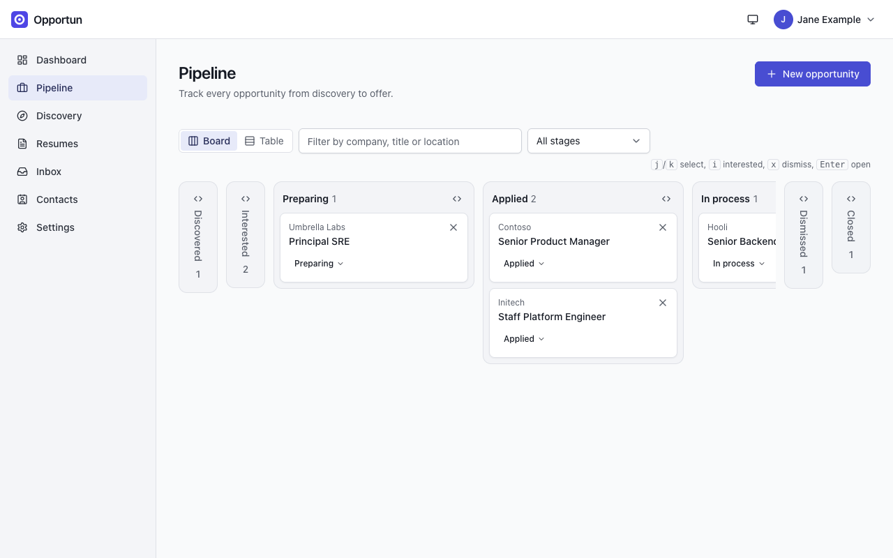
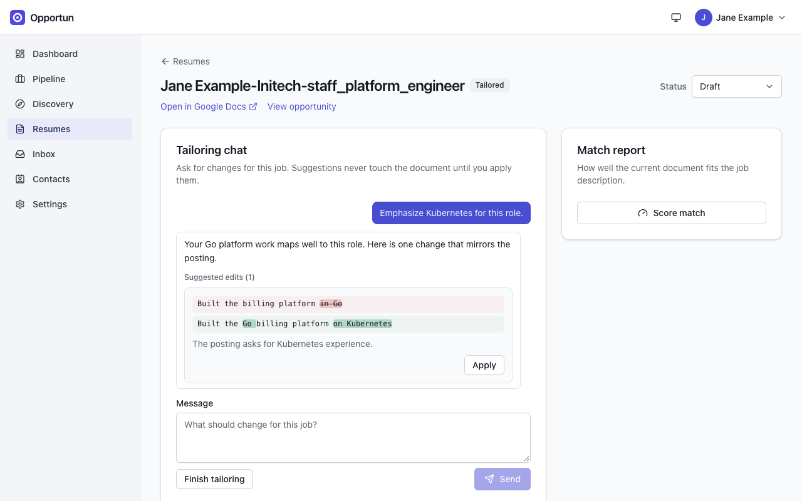
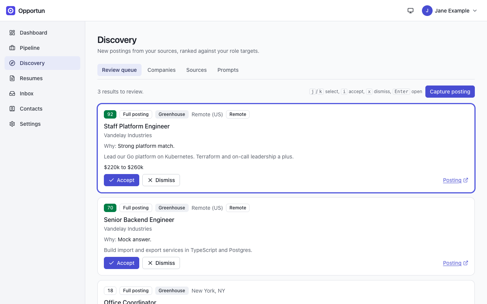
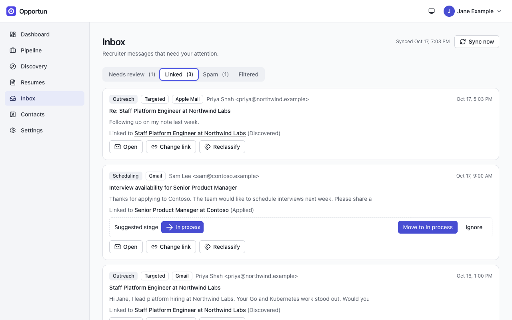
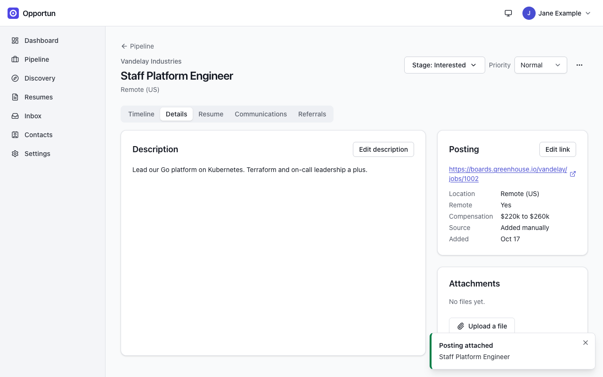

# Opportun

**An open source, AI-assisted manager for the full job search lifecycle.**

Opportun is a self-hosted web application for technology professionals running a
serious job search. It keeps every opportunity, resume version, conversation, contact,
and next step in one private place, and it puts your own AI models to work on the
tedious parts: discovering relevant postings, tailoring your resume for a specific
role, classifying and filing recruiter email, and suggesting who in your network can
refer you. This is not intended as a tool to spam your auto generated resumes to all job openings. This is meant to facilitate and automate the job search process. This app respects the access rules of all job sites.

## Why Opportun

- **Own your search.** Your pipeline, resumes, and communications live in your
  deployment, not in a job board's cloud. No telemetry, no third parties in the
  token path.
- **Bring your own AI.** Works with Anthropic, OpenAI, or any OpenAI-compatible
  endpoint (including local models). Each task is routed to a model you choose:
  small and fast for classification, your best model for resume work.
- **Transparent AI.** Every prompt the system uses is visible, versioned, and
  editable. Discovery learns from what you dismiss, but only by proposing prompt
  changes that you review and approve.
- **Human in the loop, always.** Opportun never sends an application, email, or
  message on its own. It prepares; you press send.
- **Lightweight by design.** One container, one Node.js process, one SQLite file on
  one volume. Backup is a file copy.

## What it manages

| Area                  | What you get                                                                                                                                                                                                                                                                                                                     |
| --------------------- | -------------------------------------------------------------------------------------------------------------------------------------------------------------------------------------------------------------------------------------------------------------------------------------------------------------------------------- |
| Accounts and security | Password sign-in with optional TOTP two-factor and recovery codes, sign-in with Google, GitHub or LinkedIn, an admin Users screen with password reset and open/closed registration, and per-device tokens you can revoke at any time                                                                                             |
| Profile and targets   | Multiple role targets (title, seniority, industries, location, comp), each with its own discovery criteria                                                                                                                                                                                                                       |
| Opportunities         | Full lifecycle pipeline (discovered → applied → interviews → offer → closed) with timeline, notes, next steps, and documents; one click finds a tracked opportunity's posting (from a link in a linked message, or the company's job board) and stores its text                                                                  |
| Resumes               | Base resume plus per-opportunity tailored versions in your own Google Docs or your own Reactive Resume instance, with an iterative AI tailoring workspace and your personal resume rules enforced                                                                                                                                |
| Discovery             | Pluggable sources: ATS postings APIs (Greenhouse, Lever, Ashby, Workday), your own MCP connectors, LinkedIn and Indeed job alert emails from Gmail, and manual capture, with scheduled runs, an editable ranking prompt, dismissal learning, AI company suggestions with job board detection, and a keyboard-driven review queue |
| Communications        | Gmail ingestion (read-only), AI classification, automatic linking to opportunities, solicitations turned into tracked opportunities, LinkedIn messages from your data export, and Apple Mail through a small connector that runs on your Mac (your mail password never reaches the server)                                       |
| Network               | Contacts from your LinkedIn data export or captured one profile at a time with the browser extension, mapped to companies, with AI-ranked referral suggestions per opportunity and referral asks tracked on the timeline                                                                                                         |

## Documentation

- [User guide](docs/guide/README.md): using Opportun day to day, with screenshots
- [Requirements](docs/requirements.md): what Opportun does and does not do
- [System design](docs/design.md): architecture, data model, AI subsystem, security
- [Installation](docs/install.md): deployment guide
- [Security policy](SECURITY.md): supported versions, reporting, threat model and deliberate deviations
- [Changelog](CHANGELOG.md)
- [Contributing](CONTRIBUTING.md)

## Architecture at a glance

A single Node.js (TypeScript) process serves a Fastify REST API, the React SPA, and a
durable background job runner. SQLite (WAL mode) is the default database, with Postgres 16
as an optional beta backend and a verified copy tool to move to it
([install section 15](docs/install.md#15-postgres-optional-beta)); secrets are
encrypted at rest; all integrations (AI providers, Google, job sources, MCP servers)
sit behind adapter interfaces. See [docs/design.md](docs/design.md) for the full
picture, including the security design.

## Security model

Opportun is self-hosted: your data stays on your server, and no third party sits in the
token path. Passwords are hashed with Argon2id (optional pepper), two-factor sign-in is
available to every user, and every database query is scoped to its user. AI keys and OAuth tokens are encrypted at rest under a master key kept outside
the database. Mail and captured LinkedIn pages are treated as hostile input: they are fenced
in AI prompts, and no AI output sends an application, email or message without your click.
The Apple Mail connector and the capture extension use scoped device tokens: they submit
data and cannot enumerate or fetch stored records, their responses only acknowledge what
was submitted and whether it matched an existing record, and they stop working the moment
you revoke them. The server never fetches LinkedIn pages. The
[security policy](SECURITY.md) covers the threat model, how to report a vulnerability, and
the few deliberate deviations (such as the full Google Drive scope).


## Install

Four ways in, each covered in [docs/install.md](docs/install.md):

- **Docker** (recommended): one compose file with Caddy for HTTPS, quick start below and in [section 2](docs/install.md#2-quick-start-docker-compose).
- **From source**: Node.js 22 and pnpm 9, for development or a bare-metal run, in [section 5](docs/install.md#5-running-from-source-development).
- **Apple Mail connector**: the `opportun-connector` CLI on your Mac, in [section 11](docs/install.md#11-apple-mail-macos).
- **Capture extension**: the Opportun Capture extension for Chrome or Firefox, in [section 10](docs/install.md#10-capture-extension-linkedin).

With Docker and Docker Compose v2:

```bash
git clone https://github.com/bgoleno/opportun.git
cd opportun/deploy
cp ../.env.example .env
mkdir -p data && (umask 077; openssl rand -hex 32 > data/master.key)
sudo chown -R 10001:10001 data   # Linux only; skip on Docker Desktop for Mac
docker compose up -d --build
```

To run the published image instead of building, add one line to `.env` before starting,
and leave off `--build`:

```bash
echo 'OPPORTUN_IMAGE=ghcr.io/bgoleno/opportun:latest' >> .env
docker compose up -d
```

The image is public, so no login is needed: `docker pull ghcr.io/bgoleno/opportun:latest`.
It is built for `linux/amd64` only. On Apple Silicon it runs under emulation; building from
source with the commands above is faster there. Pin a specific tag (`sha-…`, listed on the
[package page](https://github.com/users/bgoleno/packages/container/package/opportun)) rather than
`latest` if you want upgrades to happen only when you choose.

Open `http://localhost:8080` and create the first account (it becomes the
administrator). Keep `data/master.key` safe: it encrypts your stored AI keys and OAuth
tokens. HTTPS with your own domain, configuration, upgrades and backups are covered in
[docs/install.md](docs/install.md).

## Screenshots

From a seeded demo instance; every name, company and address in them is invented.

### The pipeline

Every opportunity from discovery to offer, as a board or a table, with keyboard navigation.



### Resume tailoring

Ask for a change against a specific posting. Suggestions are shown as a diff and never touch
the document until applied, and the match report scores the current document against the job
description.



### Discovery

Postings from ATS boards, your own connectors and job-alert mail, ranked by an editable
prompt, in a review queue built for the keyboard.



### Inbox

Recruiter mail triaged and linked to the opportunity it belongs to, with a suggested stage
change when the message implies one.



### An opportunity

The posting itself, stored alongside the timeline, notes, next steps and documents.



## Contributing

Issues and pull requests are welcome; see [CONTRIBUTING.md](CONTRIBUTING.md). `pnpm test`
runs the unit and integration tests and `pnpm --filter @opportun/web e2e` the
end-to-end suite.

## License

[Apache-2.0](LICENSE)
