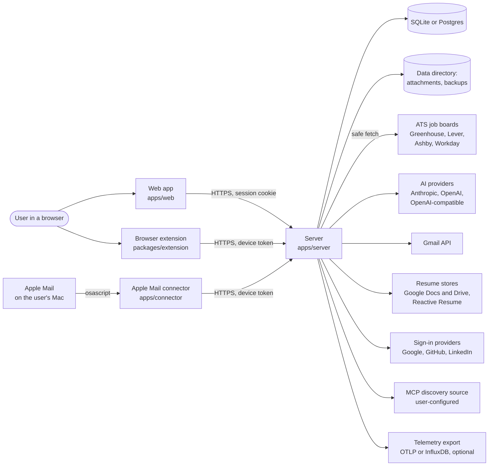
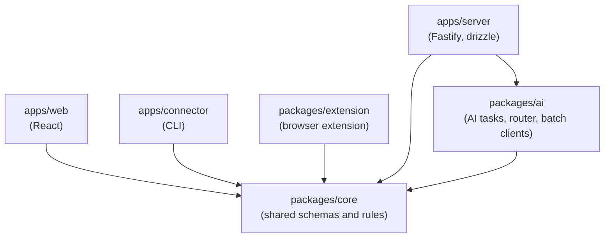
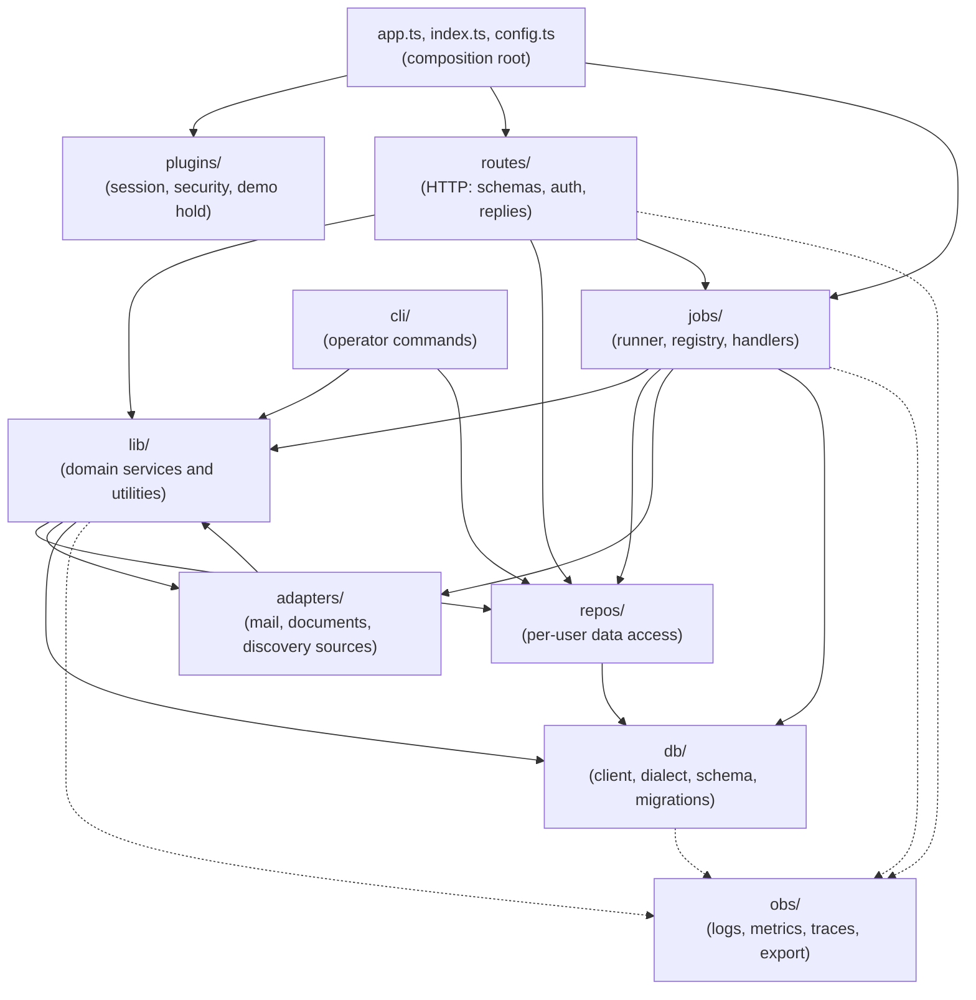
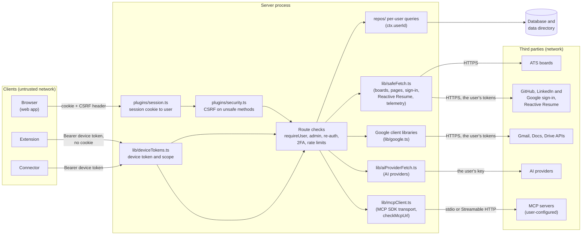

# Architecture

This document describes Opportun's design as it is, where it falls short of clean layering, and what a multi-tenant, horizontally scaled service would need to change. It proposes no rewrite. It prepares a later milestone that would rearchitect Opportun as a SaaS product (#757).

**Checked against:** `main` at `90d156505d696557566b0c41629ebd43eb2ccb22` (2026-11-21).

- **The diagrams and the dependency facts** were derived from the code at that commit.
- **The package graph** comes from each `package.json`.
- **The server's layer graph** comes from a script over every `import`/`export … from` and `import()` in `apps/server/src`, 260 files. Type-only imports (`import type`) are left out of the runtime edges, since they create no runtime dependency. The script added no dependency and did not touch the lockfile.
- **File references** are paths at that commit. Paths without a prefix are under `apps/server/src/`.

When the code changes, re-run the checks behind a diagram before trusting it.

## 1. System context

Who uses Opportun, what it runs as, and what it talks to.

- **The web app** is a React single-page app (`apps/web`) served by the server. It calls `/api/v1` with a session cookie, and with a CSRF token on unsafe methods (`apps/web/src/lib/api.ts`).
- **The browser extension** (`packages/extension`) captures LinkedIn and Indeed postings and helps fill Greenhouse application forms. It calls `/api/v1/connector/capture` and `/api/v1/connector/apply/*` with a device token and no cookies (`packages/extension/src/api.ts`).
- **The connector** (`apps/connector`) is a CLI on the user's Mac. It reads Apple Mail through `osascript` (`apps/connector/src/mail.ts`) and pushes batches to `/api/v1/connector/mail/batch` (`apps/connector/src/push.ts`) with a device token.
- **AI providers** are reached through `packages/ai` and the Vercel AI SDK (`packages/ai/src/providers.ts`), with a fetch the server builds (`lib/aiProviderFetch.ts`). Batch ranking calls the providers' batch APIs directly (`packages/ai/src/anthropicBatch.ts`, `openaiBatch.ts`).
- **Gmail** uses the user's own OAuth client (`lib/google.ts`, `routes/googleAuth.ts`).
- **The resume stores** are Google Docs and Drive, Reactive Resume, and local files (`adapters/documentStore.ts`, `adapters/reactiveResume.ts`, `adapters/localFile.ts`).
- **The sign-in providers** are Google, GitHub and LinkedIn (`lib/oauthProviders.ts`, `routes/oauthLogin.ts`).
- **ATS boards** are read by four built-in adapters (a site module each in `sites/`; Workday's is still in `adapters/sources/`), through the server's safe fetch layer (`lib/safeFetch.ts`). Job-alert mail from LinkedIn and Indeed is parsed into leads too (`lib/alertParsers`).
- **The database** is SQLite (better-sqlite3) by default, or Postgres when `DB_DIALECT=postgres` (`db/dialectName.ts`, `db/client.ts`). Files live under `DATA_DIR` (`lib/storage.ts`).

## 2. Packages and dependency direction

- **Every package depends on `packages/core`,** which depends on nothing in the workspace.
- **Only the server depends on `packages/ai`.**
- **No package imports another package's source**, and there is no cycle at the package level. The exception is tests: some server tests import `packages/ai/src` directly (for example `apps/server/test/tailoring.test.ts`), and the limit parity tests import connector and extension constants (`apps/server/test/clientLimitsParity.test.ts`).
- **The web app and the server share no code beyond `core`.** The web app defines its own request and response types for each area (see section 6.2).

## 3. The server's layers

**The intended rule** is that a layer calls only the layers below it. Solid lines are the expected directions: the composition root wires plugins, routes and jobs; routes and jobs use `lib` and `repos`; and `repos` uses `db`. `obs` is cross-cutting (dotted lines): any layer may record to it, and it should depend on nothing above `db`.

**What the code does, in runtime imports at the checked commit** (file counts per layer):

- **routes/** (41 files) → lib 142, repos 74, jobs 30, db 28, obs 16, adapters 9, plugins 5.
- **jobs/** (44) → lib 76, db 56, repos 48, adapters 20, obs 13.
- **repos/** (32) → db 55, lib 55, jobs 8, adapters 4, obs 1.
- **lib/** (75) → db 39, repos 27, jobs 13, obs 10, adapters 7, cli 2, plugins 1.
- **adapters/** (16) → lib 13, db 6, repos 6, jobs 1.
- **db/** (11) → lib 3, obs 2. **obs/** (20) → db 8, lib 4, jobs 1.

`lib/` is two layers in one. It holds domain services that sit above `repos` (for example `lib/captureResolve.ts` and `lib/postingAttach.ts`), and utilities that sit below them (`lib/secretBox.ts`, `lib/errors.ts`, `lib/safeText.ts`, `lib/storage.ts`). That is why `repos → lib` and `lib → repos` both appear. Section 6 lists the edges that go against the intended direction.

## 4. Trust boundaries

What is authenticated where, and what crosses a network boundary.

- **Browser to server:** a session cookie, resolved in an `onRequest` hook (`plugins/session.ts`, `lib/sessions.ts`) and required by `requireUser` (`repos/base.ts`). Unsafe methods also need a double-submit CSRF token (`plugins/security.ts`).
- **Extension and connector to server:** a Bearer device token with a scope (`mail:push`, `capture:push`, `apply:assist`), checked by `deviceRoute(scope)` (`lib/deviceTokens.ts`). Device routes skip the session lookup, and the security plugin refuses to register a device route that lacks the check (`plugins/security.ts`).
- **Within the server:**
  - admin routes check `isAdmin`;
  - sensitive changes re-confirm the password (`lib/reauth.ts`);
  - sign-in may require a second factor (`lib/twoFactor.ts`);
  - writes that depend on a just-proven password run under a per-user lock (`lib/passwordLock.ts`);
  - every repo query is scoped to the caller's `userId`.
- **Server to third parties:** outbound calls take one of four paths.
  - `lib/safeFetch.ts` covers the ATS boards and pages, the sign-in providers' token and profile calls, Reactive Resume, and the telemetry export. It resolves and pins addresses, checks redirects, and applies a per-host rate and a body cap.
  - Google's own client libraries (`lib/google.ts`, through `google-auth-library` and `@googleapis/*`) call the Gmail, Docs and Drive APIs with the user's tokens.
  - `lib/aiProviderFetch.ts` covers the AI providers. An operator can point a provider at its own endpoint (`ANTHROPIC_BASE_URL`, `OPENAI_BASE_URL` and an `openai_compatible` policy, described in `docs/install.md`), so not every AI call goes to a provider's public host.
  - `lib/mcpClient.ts` covers MCP discovery sources. They use the MCP SDK's own transports: Streamable HTTP, its URL checked first by `checkMcpUrl`, or stdio, a local command (`docs/install.md`, section 7).

  `SECURITY.md` states how the last two differ from `safeFetch` (its deviation on HTTP MCP sources, the AI provider path, and DNS rebinding). Users' third-party credentials are sealed at rest with the instance key (`lib/secretBox.ts`).

- **Demo servers** add a reset gate and narrow the shared accounts (`plugins/demoResetHold.ts`, `lib/demoSharedAdmin.ts`). `docs/demo-deployment.md` describes them.

`SECURITY.md` is the threat model. This diagram only places its mechanisms.

## 5. Where the code matches the layers

- **The packages are cleanly layered:** `core` at the bottom, `ai` above it, and the apps on top, with no package-level cycle.
- **Data access is per user and in one place.** Repo functions take `(db, ctx)` and filter on `ctx.userId` (`repos/base.ts`, for example `repos/opportunities.ts`). Routes reach the database mostly through repos (74 route-to-repo imports).
- **Outbound HTTP has one door for each kind of call** (`lib/safeFetch.ts`, `lib/aiProviderFetch.ts`), and `lib/storage.ts` is the only module that touches the filesystem.
- **The dialect differences live in two files.** `db/dialect.ts` holds the SQL that differs between engines, and `db/client.ts` holds the two drivers. Above them the code is dialect-free, and parity tests keep the two schemas and migration chains in step (`apps/server/test/migrationParity.test.ts`, `schemaConformance.test.ts`).
- **The job system has one runner and one registry** (`jobs/runner.ts`, `jobs/registry.ts`). Handlers declare a payload schema, and the runner owns claiming, retries and schedules.
- **AI work goes through one router** (`packages/ai/src/router.ts`), which owns budgets, time limits and run records.

## 6. Where it doesn't

### 6.1 Import cycles (runtime, file level)

There are three strongly connected groups at the checked commit:

1. **`obs` with `db/client` and `lib/safeFetch` (15 files).** `obs/catalog.ts` imports `jobs/registry.ts` (`registeredJobKinds`) and `lib/safeFetch.ts` (`ATS_ALLOW_HOSTS`). Meanwhile `db/client.ts` imports `obs/database.ts`, and `lib/safeFetch.ts` imports `obs/outbound.ts`. The catalog reads lists that its own callers own.
2. **`jobs` and `repos` (10 files).** The members are `jobs/atsDetect`, `companyDomainResolve`, `leadResolve`, `opportunityEnrich`, `lib/atsJobRef`, `repos/discovery`, `repos/opportunities`, `repos/opportunityDedupe`, `repos/submissionReview` and `repos/submissions`. Repos import pure helpers and enqueue functions from job modules, and those job modules import the repos.
3. **Mail and rejects (5 files):** `adapters/sources/alertEmail`, `jobs/mailIngest`, `repos/communications`, `repos/reject` and `repos/submissionConfirm`.

### 6.2 Layer skips (imports against the intended direction)

- **Pure helpers that live in job modules,** imported by repos and lib:
  - `boardFromUrl` (`jobs/atsDetect.ts`), imported by `lib/atsJobRef.ts`, `lib/greenhouseEmbed.ts`, `repos/submissionConfirm.ts` and `repos/submissionReview.ts`;
  - `titleOverlap` (`jobs/leadResolve.ts`), imported by `repos/opportunityDedupe.ts` and `lib/postingCandidates.ts`;
  - `invalidateTriageContext` (`jobs/mailIngest.ts`), imported by `repos/reject.ts`.
- **Repos that enqueue or schedule jobs:** `repos/opportunities.ts`, `repos/submissions.ts`, `repos/discovery.ts` (which imports `setSchedule` from `jobs/runner.ts`).
- **A job importing a route:** `jobs/postingReconcile.ts` imports `CAPTURE_MAX_TEXT` from `routes/capture.ts`.
- **An adapter importing a job:** `adapters/sources/alertEmail.ts` imports `insertLeads` from `jobs/discoveryRun.ts`.
- **Demo constants in `cli/`,** imported by runtime code: `lib/demoAccounts.ts`, `lib/demoOwnData.ts` and `plugins/session.ts` import `cli/seedDemoFixture.ts`. `jobs/demoReset.ts` imports `cli/seedDemo.ts`.
- **`lib/deviceTokens.ts` importing `plugins/security.ts`,** and `db/` importing `lib/storage.ts` and `obs/`.
- **Job handlers defined in `lib/`:** `lib/greenhouseEmbed.ts`, `lib/importer.ts`, `lib/linkedinExport.ts`.
- **Routes querying tables directly** instead of through a repo:
  - `routes/auth.ts` and `routes/oauthLogin.ts` query `users` (there is no users repo);
  - `routes/jobs.ts`, `routes/backups.ts`, `routes/importExport.ts`, `routes/integrationsMail.ts` and `routes/companies.ts` query `jobs`;
  - `adapters/reactiveResume.ts` writes `settings` rows itself.

### 6.3 Duplicated logic

- **Client copies of server contracts.** The web app defines its own types for each area (11 `apps/web/src/components/*/api.ts` files), and hand-copies server limits and shapes: 19 "mirrors the server" comments in `apps/web/src`, and 17 in `packages/extension/src`. Only some are pinned by parity tests (`clientLimitsParity`, `deviceTokenShape`, `searchParity`, `submissionRouteShape`). Examples:
  - `isTerminal` and the reopen rule, copied from `packages/core/src/stateMachine.ts` into `apps/web/src/lib/opportunities.ts`;
  - Workday and MCP config shapes, copied into `apps/web/src/components/discovery/api.ts`.
- **ATS knowledge in several places:**
  - board API URLs, in the adapters, `jobs/atsDetect.ts`, `jobs/opportunityEnrich.ts` and `lib/greenhouseEmbed.ts`;
  - API hosts, in both `lib/safeFetch.ts` and `obs/outbound.ts`;
  - the ATS kind list, in `adapters/discoverySource.ts`, `jobs/atsDetect.ts` and the web.
- **Admin checks done three ways:** `fail(reply, 403)` in `routes/auth.ts`, `throw forbidden()` in `routes/backups.ts`, and a local `requireAdmin` in `routes/oauthLogin.ts`.
- **Resume-store dispatch repeated** in `routes/resumes.ts`, `jobs/submissionSnapshot.ts` and `lib/importer.ts`, with two names for one store (`google` and `google_doc`).

### 6.4 Docs behind the code

`docs/design.md` still names `/api/ingest` for the connector, which is now `/api/v1/connector/mail/batch`. It has no Workday adapter in its list, and it names `googleapis` where the code uses the `@googleapis/*` packages.

## 7. Extension points: how to add something today

| To add                        | Steps and files                                                                                                                                                                                                                                                                                                                                                                                                                                                                                                                                                                                                                                     |
| ----------------------------- | --------------------------------------------------------------------------------------------------------------------------------------------------------------------------------------------------------------------------------------------------------------------------------------------------------------------------------------------------------------------------------------------------------------------------------------------------------------------------------------------------------------------------------------------------------------------------------------------------------------------------------------------------- |
| **A discovery source or ATS** | 1. Add the kind to `DISCOVERY_SOURCE_KINDS` (`packages/core/src/schemas/discovery.ts`). 2. Write `adapters/sources/<name>.ts` implementing `DiscoverySource.fetchPostings`, and call `registerBuiltinSource`. 3. Import it in `adapters/sources/index.ts`. 4. Add its config schema to `SOURCE_CONFIG_SCHEMAS` (and `ATS_SOURCE_KINDS` for a board). 5. Add its API host to `ATS_ALLOW_HOSTS` (`lib/safeFetch.ts`) and `TARGET_BY_HOST` (`obs/outbound.ts`). 6. Optionally add detection (`jobs/atsDetect.ts`) and a job-id parser (`lib/atsJobRef.ts`). 7. List it in the web (`components/discovery/api.ts`, `SourceForm.tsx`). |
| **A job kind**                | 1. Write a `JobHandler` (kind, payload schema, max attempts, run) and register it in `jobs/index.ts`. 2. Enqueue it with `enqueue(db, kind, payload)` (`jobs/runner.ts`), and get services through `requireService`. 3. For a schedule, export a cron and call `seedSchedule` in `app.ts`, or `setSchedule` for a per-user one. 4. For a concurrency cap, add the kind to `DEFAULT_KIND_LIMITS`.                                                                                                                                                                                                                                           |
| **An AI task**                | 1. Add the key to `TASK_KEYS`, a default policy (`policies.ts`), its inputs and output schema (`tasks.ts`), and a feature mapping (`features.ts`). Typecheck enforces the mapping. 2. Seed its prompt with a migration in both `drizzle/` and `drizzle-pg/`. 3. Call it with `getActivePrompt`, `renderPrompt` and `runStructured` or `streamChat`, passing `buildAiDeps`. Budgets are per task (`lib/ai.ts`), with prices in `packages/ai/src/pricing.ts`.                                                                                                                                                                                   |
| **A resume store**            | 1. Implement `DocumentStore` (`adapters/documentStore.ts`), add a value to `RESUME_STORES` (core), and wire it in `app.ts` and `JobServices`. 2. Extend every dispatch site: `routes/resumes.ts`, `jobs/submissionSnapshot.ts`, `lib/importer.ts`.                                                                                                                                                                                                                                                                                                                                                                                               |
| **An API route**              | 1. Export a plugin using the zod type provider (pattern: `routes/jobs.ts`), and register it in the `/api/v1` block of `app.ts`. 2. Declare zod schemas for params, query, body and responses. 3. Use `requireUser` for a session route, or `deviceRoute(scope)` for a device route. An admin route calls `requireAdmin` (`repos/base.ts`) instead, and a shared-demo admin route goes in `SHARED_ADMIN_ROUTES`.                                                                                                                                                                                                                               |

**How each extends:**

- **Job kinds and AI tasks:** a registry, a few lines each.
- **A discovery source:** a registry too, but its host lists and the web's copy of the kind list must be kept in step by hand.
- **A resume store:** needs edits at every dispatch site.

## 8. SaaS readiness: the seams

Each seam below is what a multi-tenant, horizontally scaled service would need, sized roughly. S means days, M a few weeks, L a month or more, and XL a quarter. None of these is proposed for now.

### 8.1 Tenancy and isolation (M)

- **Now:** the user is the only tenant unit. Every domain table has `user_id`, and every repo query filters on it through one helper, `ownedBy` (or `ownedSql` for hand-written SQL) in `repos/base.ts` (#768), which a test keeps that way. Some rows are instance-wide: settings with a null `user_id` (registration, sign-in provider clients, telemetry, the pepper version, schedules), system prompts, jobs and audit rows. `users.is_admin` makes someone an admin of the whole instance. Demo accounts are pinned ids, reset nightly (`jobs/demoReset.ts`).
- **To change:**
  - separate the platform operator from an in-app admin, and move instance settings to platform configuration or to per-tenant rows;
  - add per-tenant quotas;
  - fan out instance-wide jobs that loop over all users;
  - if organisations are wanted, add a second scope key to every `owned…` helper, ideally through one shared helper first;
  - make the demo a separate deployment.

### 8.2 Job queue and scheduling (M)

- **Now:** jobs are rows in `jobs`, claimed with one `UPDATE … RETURNING` (plus `FOR UPDATE SKIP LOCKED` on Postgres, `db/dialect.ts`). A pool of 4 workers polls every second (`jobs/runner.ts`), with retries, backoff, a dedupe key, and cron schedules kept as settings rows. The claim is already safe for several workers. Four things assume one process:
  - orphan recovery returns every `running` row to pending at startup. On Postgres the runner also looks every minute for `running` rows of its own worker id that it has not in hand (a claim's answer lost with its connection, an end that could not be written) and ends them; the claims in hand, and the ends it keeps to write, are in memory;
  - per-kind caps are counted in a process-local map;
  - the backup queue lives in memory;
  - the boot sweep of posting checks (`settleAbandonedChecks`, `lib/postingChecks.ts`, run from `app.ts` before the runner starts) ends every posting still `searching` that has no pending or running check job. It reads that as "nothing is left to finish it" only because no request has been served yet: a capture sets `searching` and then queues its job (`lib/captureResolve.ts`), as two writes, so a second process that was already serving requests could have a capture between them, and the sweep would end that check.

  `docs/adr/0004-postgres.md` keeps a second process out of scope.

- **To change:**
  - lease or heartbeat-based recovery (`locked_at` exists);
  - kind caps counted in the database;
  - worker processes separate from web processes;
  - optionally `LISTEN/NOTIFY` instead of polling;
  - per-tenant fairness in the queue.

### 8.3 In-process state and caches (M)

- **Now:** these are per process by design. Each is right for one process, and would be per process only if there were several:
  - the request rate limiters (`lib/rateLimit.ts`, used by `lib/reauth.ts`, `lib/captureLimit.ts` and routes) and the capture slot queue;
  - safe fetch's per-host request buckets (`lib/safeFetch.ts`);
  - the single-use sign-in state (`lib/oauthState.ts`);
  - the demo reset gate (`lib/demoResetGate.ts`);
  - the mail triage cache (`jobs/mailIngest.ts`, 5 s);
  - the vendor-check queue (`jobs/vendorCheckQueue.ts`);
  - the job runner's claim gate and kind counts;
  - the SQLite write gate (`db/gate.ts`);
  - the telemetry settings and buffers (`obs/`), where a settings change applies only in the process that made it.

  Password and scope locks already use database advisory locks, and sessions are database rows.

- **To change:** a shared store (Postgres or Redis) for the buckets, limiters, slots and single-use state; settings changes that reach every process (notify, or a short re-read); and the demo gate staying a single-process feature. Each site is small and already sits behind a function.

### 8.4 File and attachment storage (M)

- **Now:** `lib/storage.ts` is the only filesystem user, rooted at `DATA_DIR`. Attachments are content-addressed (`attachments/<aa>/<sha256>`), and backups and exports are files written with atomic moves. The orphan sweep (`jobs/attachmentSweep.ts`) relies on file modification times.
- **To change:**
  - an object-store implementation of the attachment methods (keys map directly from the hash);
  - a different sweep rule, using object timestamps or reference counts;
  - upload semantics for backups and exports;
  - signed or streamed downloads.

  The database-file methods fall away on Postgres.

### 8.5 Configuration and secrets (M)

- **Now:** `config.ts` loads and validates the environment, `_FILE` variants included, but a few modules still read `process.env` directly (`jobs/runner.ts`, `lib/ai.ts`, `lib/aiProviderFetch.ts`, `db/schema.ts`). One instance master key seals per-user secrets with AES-256-GCM (`lib/secretBox.ts`): AI keys, OAuth tokens, device-token material and TOTP secrets. The sealed format carries a key version, but only version 1 exists. Password peppers are versioned, with an upgrade on sign-in.
- **To change:**
  - a KMS or envelope encryption, with per-tenant data keys if wanted;
  - real key rotation, which means a re-encryption backfill over every sealed column;
  - a secrets manager feeding configuration;
  - every environment read moved into `config.ts`.

### 8.6 The SQLite path (S for SaaS on Postgres; L to remove SQLite)

- **Now:** the dialect is chosen once at startup. Repos are typed against the SQLite schema, and Postgres runs behind the same types ("dialect erasure", `db/schema.ts`). Differences live in `db/dialect.ts` and `db/client.ts`. SQLite has pieces of its own:
  - the WAL checkpointer;
  - FTS5 search, where Postgres uses tsvector;
  - backups by `VACUUM INTO`, where Postgres uses `pg_dump`;
  - integrity checks.

  Migrations are written twice (`drizzle/`, `drizzle-pg/`) and kept in step by parity tests and a two-dialect CI matrix. A one-way copy tool moves a SQLite instance to Postgres (`lib/copyToPostgres.ts`).

- **To change:** a SaaS build would run on Postgres only, which already works. SQLite can stay for self-hosting, at the cost of writing each migration twice. Removing it from the code would be larger, because of the type erasure.

## 9. Proposed follow-up issues (for the EM to file)

1. **Move pure helpers out of job modules into `lib/`** (`boardFromUrl`, `titleOverlap`, `invalidateTriageContext`, `insertLeads`, `CAPTURE_MAX_TEXT`), to break cycles 2 and 3 and the job-to-route import. S.
2. **Make `obs/catalog.ts` take its job kinds and ATS hosts as data,** passed in at startup, to break cycle 1. S.
3. **Move the demo constants out of `cli/`** into `lib/demo/`, and have `cli/` import them. S.
4. **A users repo and a jobs repo,** used by `routes/auth.ts`, `routes/oauthLogin.ts` and the five routes that query `jobs`. M.
5. **One `requireAdmin` helper** in `repos/base.ts` or `lib/`, used everywhere an admin check is done inline. S.
6. **One ownership helper** for the per-repo `owned…` predicates, to prepare a second scope key. S.
7. **One source of ATS knowledge:** board URLs, hosts and kinds defined once, and used by the adapters, detection, enrichment, safe fetch and telemetry. M.
8. **Share the web's API types through `packages/core`,** area by area, starting with the copies the "mirrors the server" comments name. Add parity tests where a copy must stay. M to L, incremental.
9. **One resume-store registry,** replacing the three dispatch sites, with one store vocabulary. S.
10. **Bring `docs/design.md` up to date** (the connector path, Workday, the Google packages). S.
11. **Move the direct `process.env` reads into `config.ts`.** S.
12. **For the SaaS milestone, when it starts:** lease-based job recovery and database-counted kind caps (8.2); a shared store for in-process limiters and buckets (8.3); an object-store backend (8.4); key versions and rotation (8.5). Each is M.
