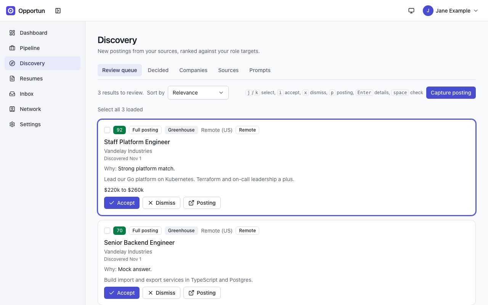
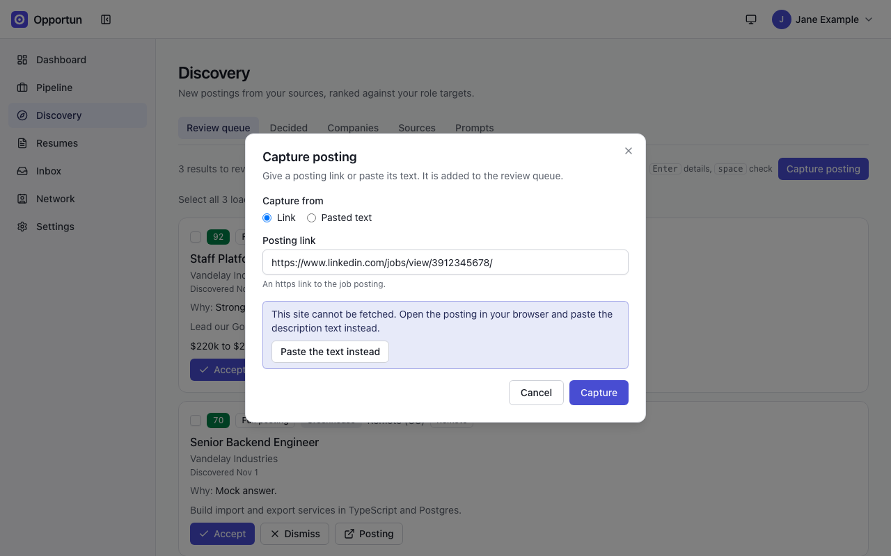
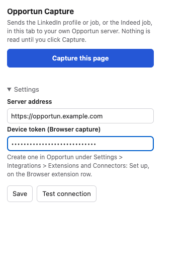
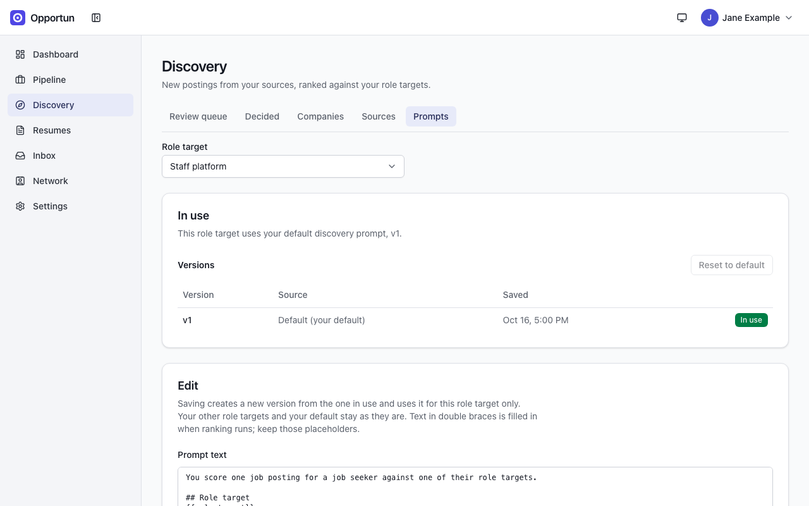

# Discovery

[Guide home](README.md) · Previous: [Mail filters](mail-filters.md) · Next: [Browser extension](browser-extension.md)

Discovery finds new postings, ranks each one against your role targets with AI, and puts
them in a review queue. Nothing reaches your pipeline until you accept it.

**Discovery** has five tabs: **Review queue**, **Decided**, **Companies**, **Sources** and
**Prompts**.

## Where postings come from

| Source             | How it works                                                                |
| ------------------ | --------------------------------------------------------------------------- |
| Company job boards | Greenhouse, Lever, Ashby and Workday, read through their public job APIs    |
| Followed companies | A company you follow gets its job board detected and becomes a board source |
| Job alert emails   | LinkedIn and Indeed job alert digests in your Gmail become leads            |
| Manual capture     | A posting link or pasted text                                               |
| Capture extension  | A LinkedIn job page you send from your browser                              |
| MCP                | A tool on an MCP server you run yourself                                    |

### Add a board source

On **Sources**, press **New source** and choose a kind:

- **Greenhouse, Lever, Ashby**: enter the board slug (for Greenhouse, the `<slug>` in
  `boards.greenhouse.io/<slug>`).
- **Workday**: paste the company's career site URL, or any posting on it. The `wd1`/`wd5`
  part of the host is kept as given. Workday describes each posting with an extra request, so
  a run fetches at most 200 new descriptions and leaves the rest for the next run. Workday
  sites go down for a weekly service window; a run during it fails and a later one succeeds.
- **MCP**: see [install guide section 7](../install.md#7-configuring-discovery-sources).
  Sources that run a local command are admin-only.

Each source takes an optional **schedule** (cron, for example `0 7 * * *` for daily at
07:00; empty means it only runs when you press run) and an optional **role target** (empty
ranks against all your role targets). The Sources table shows each source's status, last
and next run, an enabled switch, and actions to run it now, see its run history, edit or
delete it.

Below the table, **Posting volume and ranking cost** shows each company board's open jobs at its
last run and, over the last 14 days, its new postings a day, the ranking calls that means, and
what they cost at the last 30 days' average cost per call. A board's first run brings in the whole
board, so it is left out: after only one run, those figures say "no data yet".

**A new board's first run.** The first time a company board runs successfully, Opportun ranks only
its 25 best matches, judged by the [pre-filter](#the-pre-filter) and then the newest, so adding a
large board does not send all of it to the AI at once. The rest
are stored and shown in the queue as **Not ranked: below the cut**. To rank them, choose **Rank
these** on that source's row in the Sources table. It shows how many there are and the estimated
cost, based on your average cost per ranking call over the last 30 days, before anything runs. Once
you confirm, they go through your [discovery budget](settings.md#models-and-budgets) like any other
posting, so any that do not fit today wait for a later budget day. Later runs of that board are not
capped, and a large Workday board brings in its postings over several runs, so those runs can still
fill the budget for a while.

### The pre-filter

Before a company board's new posting goes to the AI, Opportun compares its title, place and remote
setting with your role targets, with no AI call and no cost. It only rules a posting out on what the
posting clearly states.

At first it only measures. Once you have accepted at least 20 job board postings and it would have
kept at least 95% of them, it turns on by itself: a posting it rules out gets no AI call, and its
card says **Filtered** and why, with **Rank anyway**. **Settings > AI > Discovery pre-filter** says
whether it is on and why not, and the share of postings it would filter. It is checked at the start of
each run, so if the figure falls back below the bar, new postings are ranked again; those already
filtered stay filtered until you send them.

The figure can read high once it is on, because you rarely accept a posting with no score. A filtered
posting you accept anyway counts against it.

To turn it off for one board, clear **Pre-filter** on that board's row in the Sources table. Its new
postings are then all ranked; any it already holds stay held until you choose **Rank anyway**. Job
alert emails are never filtered.

### Where to look

**Where to look**, at the top of the **Companies** tab, is your industry profile: the industries
worth looking for companies in, from the [NAICS 2022](https://www.census.gov/naics/) list at its
4-digit level. It is collapsed until you open it, and its heading shows how many are confirmed and
how many wait for you.

**Suggest industries** makes one `discovery.industry_profile` AI call, and only when you press it.
It sends your AI provider the text of your base resume (the one you changed last) and, for each
active role target, its title family, industries and keywords. It sends nothing about your contacts,
companies or opportunities. The call counts against your
[discovery budget](settings.md#models-and-budgets), and over it the button tells you instead of
calling.

Each suggestion has a tier (**Core**, an industry you have worked in; **Similar**, in the same
sector as a core one; **Adjacent**, in another sector but closely tied to a core one), a one-line
reason, and where it was read from. Only codes on the NAICS list are kept. A suggestion does not
count until you press **Confirm**. **Remove** takes a row away, and **Add** puts in any industry from
the list, confirmed. Asking again replaces what you have not confirmed and leaves what you have. A
removed industry can come back if a later suggestion proposes it again.

### Follow companies

The **Companies** tab has one list, **Recommended companies**, under [Where to look](#where-to-look).
It holds every company where someone in your contacts works now, read from your own contacts, and
every company the AI suggested, each once; a company that is both shows both badges, **In your
network** and **AI suggested**. Each row shows whether Opportun has found its job board (found, not
checked yet, or no board found), why it is there, and **You know N people here**; open that to see
their names. A suggestion says why it was suggested. A company with an industry says it against your
confirmed industries: its title and your tier for it, with the reason you confirmed, or **other
industries** when it is not one of yours.

**Follow** one and Opportun looks for its job board, and it then shows **Following**. **Deny** one
and it leaves this list and joins **Denied companies**. Followed and denied companies are left out
until you tick **Show followed** or **Show denied**; a denied one has **Undo**. If the list is empty,
add your contacts' current companies under [Network](network.md).

Filter the list by **Source** (in your network, AI suggested), **Industry** (each of your confirmed
industries, by tier, then other industries and not tagged yet) and **Board**, and sort it by **Most
people you know** or **Best fit** (your own industries first, then similar, adjacent, other, and not
tagged). Showing, filtering and sorting use what Opportun already has: they check no job board and
send nothing to your AI provider.

**Industry tags.** Each suggested company, and each company in your network that you have not
followed or denied, gets an industry from the [NAICS 2022](https://www.census.gov/naics/) list. A
nightly `discovery.company_tags` run asks your AI provider about 20 companies at a time, on a cheap
model, and it counts against your [discovery budget](settings.md#models-and-budgets): over it, the
rest wait for a later night. Each call sends the company's name, its domain, and up to 10 job titles
from postings already stored from its board. So the names of companies in your network do go to your
provider; nothing about your contacts does, and no board is fetched for this. A tag is created once
and kept. Until then a row says **Industry: not tagged yet**. Open **Industry** on a row to correct
it, and your choice stands (the row then says "set by you"). A company the model could not place
says **Industry: could not be placed** and is not asked about again until job titles arrive from its
board: then it is asked once more, with those titles, and once more for each later arrival. You can
still set one yourself at any time. A company the provider refuses, or answers unusably, when asked
on its own is asked again the next night, after the other companies, so one name that always fails
does not hold the rest up. With no AI key, or a key the provider rejected, the run does not start. A
suggested company already has the industry it was suggested for (see below), so it is not asked
about, unless that industry could not be read as a code from the list, in which case the nightly run
asks as for any other company.

**AI suggested companies** come from the `company.suggest` task, which once a week (Tuesdays)
proposes companies worth following, each with its reason, the industry it was suggested for and
that industry's tier. It looks for companies in the industries you confirmed under
[Where to look](#where-to-look), like the companies in your network and your pipeline, and it
drops any suggestion outside those industries. Until you have confirmed an industry, it suggests as
before, from your role targets and past decisions, and nothing is dropped. **Follow** one and
Opportun looks for its job board; **Deny** it and it is not suggested again. The weekly call counts
against your [discovery budget](settings.md#models-and-budgets): with no room left that day it runs
again at the start of the next budget day, not the next week.

If you edited the `company.suggest` prompt yourself, your version keeps its wording and does not
use the new inputs until you add `{{industry_profile_untrusted}}` and
`{{network_companies_untrusted}}` to it (or take the new default). Without the industries, most of
the codes the model gives will be outside your confirmed industries, and those suggestions are
dropped.

**What the suggestions send.** The call sends your AI provider your role targets, your confirmed
industries (the code, its title and tier, and the one-line reason), the names of the companies in
your pipeline and the companies you denied, the job titles you recently accepted or dismissed, and
**the names of the companies where you know someone: their names only, never a person**. That
list is the 500 companies where you know the most people, the most first, and it is sent every week
with no setting to turn it off. No contact's name, email, notes, LinkedIn address or tags, and no
count of how many people you know, is sent.

**The board check.** After each run, every new suggestion gets one board check with no AI call:
Opportun finds its public job board, reads the list of its open jobs once, and keeps how many
there are and how many of them the [pre-filter](#the-pre-filter) passes for your role targets. It
only reads public job board pages, and it does not follow the company: the board stays switched off
until you follow it.

**Check board.** A company in Recommended companies that has not been checked, from your network or
a suggestion, has a **Check board** button. Nothing checks a company you have not asked about:
only your click does, and only for that company, once. It does what the weekly check does: it looks
for the company's public job board (the company's name, as board-name guesses, goes to the Greenhouse,
Lever, Ashby and Workday public pages, as following does), reads the list of its open jobs once, and
keeps how many there are, how many the pre-filter passes, and up to 10 of the job titles. No AI call
is made, and the company is not followed. The row says **Checking board...** and shows the result
when it is done. You can check up to 30 companies an hour; past that the button says when to try
again. A company with no board found says so, and its **Follow and add careers page** button follows
it so that you can add the careers page under Followed companies. The job titles are also what the
nightly industry tags use for a company with no postings stored yet, and a check that reads titles
after the model could not place a company has it asked again.

**The estimate line.** A row whose board was checked says what following it would bring, for example
"about 4 new a day, est. $0.02 a day; first run 25, $0.50". New postings a day are 2% of the open
jobs until the board has its own 14 days of runs, and then what it has seen. While the pre-filter is
on (see [The pre-filter](#the-pre-filter)) only the postings it passes are counted as ranked, and
otherwise all of them. The first run ranks at most 25. Dollars use the average cost of a ranking call
over the last 30 days, the same figure Discovery shows; with no call in 30 days the line says "cost
not known yet". A followed company (under **Show followed**) shows the daily part only.

**Select, and the budget.** Tick the boxes on several companies to see what following them together
would bring: a bar at the bottom of the list totals the new postings a day, the ranking cost a day,
and the first runs, and counts the selected companies that have no estimate yet, naming them under
**without an estimate**. Beside the list (below it on a phone), **Today's discovery budget** shows
what has been spent of your [discovery budget](settings.md#models-and-budgets) and what the
selection's first runs would take it to. **Follow** and **Deny** in the bar act on the whole
selection; one that fails does not stop the others, and the toast says which were done and why the
others were not, which stay ticked. A follow asks first, with the figures for each company, when its
first runs would cost more than $1.00 in all, would bring more than 20 new postings a day, or would
take today's spend over your budget; any other follow acts at once. Changing a filter drops the
companies it hides from the selection.

**From the keyboard.** `j` and `k` move through the companies, `Space` ticks the one you are on, `f`
follows it (with the question above when it applies), `x` denies it, and `Escape` clears the
ticks. `?` lists every shortcut. They do nothing while you are typing in a field or a menu, or while
a dialog is open.

_The Companies tab, with invented contacts, after the nightly industry tags ran. Following a company starts job board detection._

A followed company shows the board it found (for example "Greenhouse: piedpiper") and a
**Detect now** button; boards are re-checked weekly. The detected board becomes a source that
runs daily. If no board is found, the card asks for the company's careers page URL so it can
be scanned. Workday boards are only detected from a URL (a careers page on Workday, or
Workday links on the company's careers page), never guessed from the name.

### Job alert emails

If Gmail is connected, LinkedIn (`jobalerts-noreply@linkedin.com`) and Indeed
(`alert@indeed.com`) job alert digests are recognized during Gmail sync by default, and each
job in them becomes a lead in the review queue. Digests skip the AI classifier and never
appear as inbox messages to triage. **Edit alert senders**, on the Sources tab, lets you add
or remove senders, or reset to the built-in LinkedIn and Indeed pair; an address only does
anything once a digest from it actually matches one of Opportun's two understood layouts, so
adding an arbitrary sender does not teach it a new one. (The screenshots here come from a test
mailbox without alert digests, so none are shown.)

## The review queue

The queue lists new results, best score first. Each shows the AI score (0 to 100) or
**Unscored**, badges for how complete the posting is, its source, location and remote status, the
AI's one-line reason, the start of the description, the pay if listed, and a link to the posting.

An unscored result can say why, in a line on its card:

- **Waiting for budget**: it is ranked when your [discovery budget](settings.md#models-and-budgets)
  has room.
- **Filtered: title**, **Filtered: remote** or **Filtered: location**: the
  [pre-filter](#the-pre-filter) judged it clearly not a fit, so it was not sent to the AI. **Rank
  anyway** on the card sends it.
- **Not ranked: below the cut**: a board's first run ranks only its 25 best matches. **Rank these**
  on the [Sources](#add-a-board-source) tab sends the rest.
- **Not ranked: AI is not set up (Settings > AI)**: there is no AI key to rank it with. Once a key
  works (you add one, or change the Discovery ranking model to a provider you have a key for), every
  such posting waits for [budget](settings.md#models-and-budgets) and is ranked, with nothing more
  to do. Postings below the cut or filtered stay as they are, for you to send.
- **Not ranked: the AI provider rejected your key. Add a working key, or press Validate once it works, in Settings > AI**: the provider refused the key, so the app has stopped its hourly tries. Adding a working key, or pressing **Validate** on this one once it works, starts ranking what waits. So does a change to the Discovery ranking model, or a new posting that ranks.
- **Not ranked: the AI provider was unavailable** or **Not ranked: the AI's answer could not be
  used**: the call failed.

On any result:

- **Accept** adds it to your pipeline in New. If it matches an opportunity you already
  track, you are asked to attach it there instead, or accept it anyway (see
  [Pipeline](pipeline.md#possible-duplicates)).
- **Dismiss** asks for a reason (Seniority, Compensation, Location, Industry, Company,
  Stale, Other) and an optional note.
- Keyboard: `j`/`k` select, `i` accepts, `x` dismisses, `Enter` opens.

_The review queue, ranked against the "Staff platform" role target. The selected result has a blue outline._

**Cost and limits.** Ranking spends from your [discovery budget](settings.md#models-and-budgets); over it a posting waits for the next budget day rather than being skipped, and a scored posting waiting to be ranked again says its score may change. Ranking is one `discovery.rank` call per new posting (a source with no
role target is judged against all your role targets in that one call). A busy board on a daily schedule can mean dozens of calls a day. For the first week, watch
**Posting volume and ranking cost** on the Sources tab, and **Usage** and
[**Discovery ranking cost**](settings.md#models-and-budgets) under **Settings > AI**, and narrow
your sources if needed. The score is the model reading your role target and the posting text; it misses things a posting leaves
out, so skim the low scorers occasionally.

**The title pre-filter.** Each new posting from a job board also gets a pass or filtered verdict from
a cheap, local check, as [The pre-filter](#the-pre-filter) describes. **Decided** shows how often it
would keep the job board postings you accepted, with the count. That figure is worked out each time
against your current role targets, so it includes postings you accepted before this existed, and it
moves when you edit a target. Postings from job-alert emails are not checked.

The location check is deliberately lenient. It filters a posting only when it names a place that
is clearly not one of yours. A posting saying "Multiple locations" or "United States" is kept, and
a target with a country, state or region among its locations (such as "Texas" or "Europe") filters
on no location at all. It does not know which towns surround a city, so a target of "Seattle" would
still filter a posting in "Bellevue, WA".

It compares titles with each role target's **title variants** (**Settings > Role targets**):
20 to 40 equivalent titles, made by one `discovery.title_variants` AI call when you add a target
or change its name or title family. That call sends the target's name, title family, seniority
range and keywords, and nothing else. A target with no list yet, because it is older than this
feature or the call found no AI key or budget, gets its call when you add a key or in a nightly
sweep, without you doing anything. You can edit the list, and a list you save or clear stays as
you left it, even if a call was already running. A new name or title family replaces it with a
fresh one, unless you edit the list in the same save.

## Decided results

Accepting or dismissing a result keeps a later sighting of the same job (same company, title
and location, however it resurfaces) from showing up in the queue again, rather than treating
it as new each time. **Decided**, with its own **Dismissed** and **Accepted** tabs, is where
those settled results live.

Dismissed a result that was wrong to skip, or a requisition reopened later? **Unsuppress**
lets the next repost through to the review queue again, instead of it being silently treated
as the same job forever. For an accepted result, unsuppressing only takes effect once the
opportunity it became is itself dismissed; while that opportunity is still active, a repost
should keep being treated as the same job.

Once unsuppressed, a result shows an **Unsuppressed** badge in place of the button. Reversing
a decision and never having made one are different states, and collapsing them into one
undifferentiated row would leave no way to tell, at a glance, which ones were already
reopened and which still hold their key.

## Capture a posting yourself

**Capture posting** (on the review queue) takes a posting link or pasted text, extracts the
company, title, location and description, and adds the result to the queue. If extraction
cannot find the essentials, it tells you to create the opportunity by hand instead. It shares
one limit with the browser extension, 60 captures per 15 minutes for your account; when that is
reached, the dialog says when you can capture again.
If another capture of yours is still being saved, the dialog says so and to wait a few
seconds and press **Capture** again; that is not a limit.

Opportun never fetches LinkedIn or Indeed pages. A LinkedIn or Indeed link is refused with a
prompt to paste the description text instead, or capture the job with the
[browser extension](browser-extension.md) from your own browser.

_A LinkedIn link is refused before anything is fetched; paste the text or use the extension._

### The capture extension

The **Opportun Capture** extension (Chrome, Chromium browsers and Firefox 128+) sends the
LinkedIn profile or job, or the Indeed job, you are looking at to your server, only when you
click **Capture this page**. A captured job becomes an opportunity at **Interested** and does not
pass through this queue: capturing one is how you say you want it. If the job is already
sitting here as a lead from an alert email, that lead is completed and accepted rather than
duplicated. Profiles become contacts (see [Network](network.md)). The
[browser extension](browser-extension.md) page covers what happens next.

1. Create a device token with the **Browser capture** permission under **Settings >
   Integrations > Extensions and Connectors**.
2. Install it from **Settings > Integrations > Extensions and Connectors**; the full story is
   in [Browser extension](browser-extension.md).
3. In the popup, open **Settings**, enter your server address and the token, **Save**, then
   **Test connection**.

_The extension popup, with Settings open. (Captured by loading the built extension into Chromium and opening its popup page in a tab.)_

Each token can capture 30 pages per 15 minutes, and your account 60 per 15 minutes across every
token and the Capture posting dialog. Only profiles and job pages are accepted;
feeds, search results and company pages are refused.

## Ranking prompts

The **Prompts** tab shows the prompt each role target ranks with: its versions, which one is
in use, and an editor. Saving creates a new version for that role target only; your other
role targets and your default prompt are untouched. **Reset to default** goes back. Keep the
`{{...}}` placeholders: they are filled in when ranking runs.

_Every prompt is visible and versioned. Edits apply to one role target._

## Dismissal learning

Your dismissal reasons are not wasted. Once a week (Wednesdays), for each role target with at
least five dismissals since the last refinement (from the review queue, or opportunities
dismissed in the pipeline), the `discovery.refine_prompt` task proposes a revised ranking
prompt. The proposal shows on the Prompts tab with a summary and a diff against the version in
use. **Accept** makes it the role target's prompt; **Discard** drops it. Nothing changes
without your accept.

<!-- nav:bottom -->

---

| [← Mail filters](mail-filters.md) | [Guide home](README.md) | [Browser extension →](browser-extension.md) |
| :-------------------------------- | :---------------------: | ------------------------------------------: |
