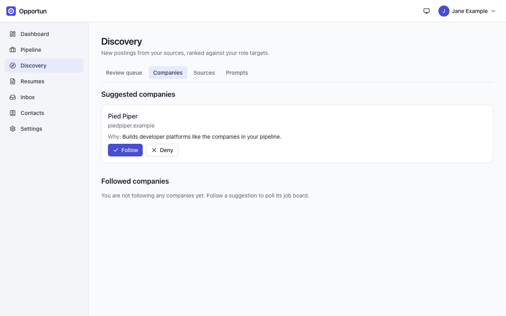
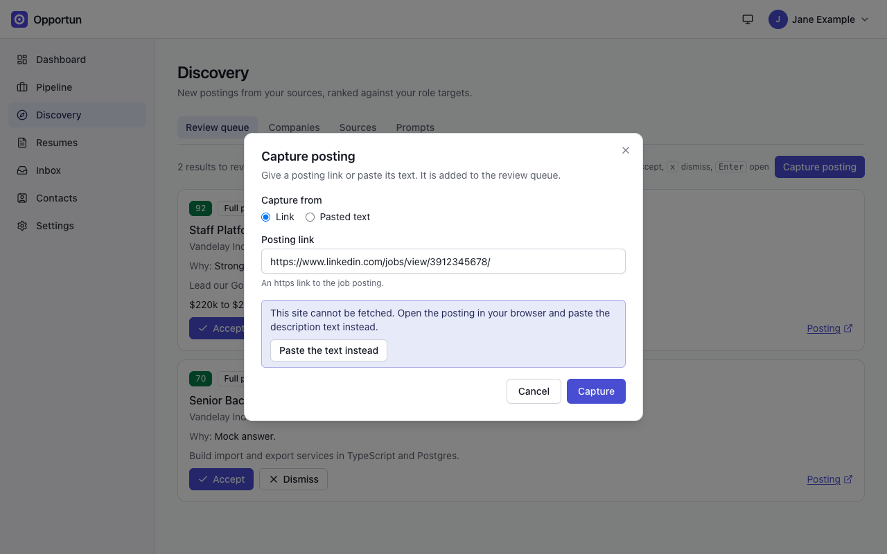
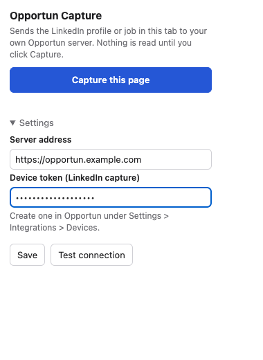
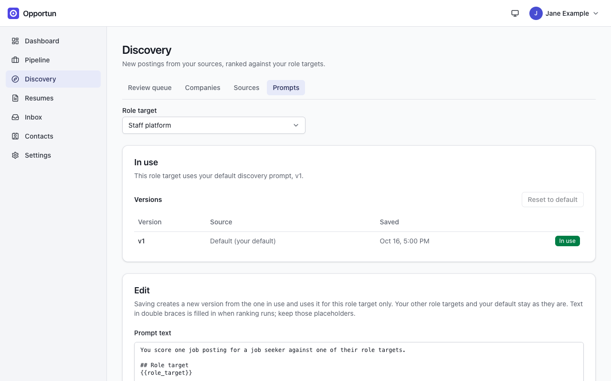

# Discovery

[Guide home](README.md) · Previous: [Inbox](inbox.md) · Next: [Network](network.md)

Discovery finds new postings, ranks each one against your role targets with AI, and puts
them in a review queue. Nothing reaches your pipeline until you accept it.

**Discovery** has five tabs: **Review queue**, **Decided**, **Companies**, **Sources** and
**Prompts**.

## Where postings come from

| Source             | How it works                                                                |
| ------------------ | --------------------------------------------------------------------------- |
| Company job boards | Greenhouse, Lever, Ashby and Workday, read through their public job APIs    |
| Followed companies | A company you follow gets its job board detected and becomes a board source |
| Job alert emails   | LinkedIn and Indeed job alert digests in your Gmail become leads            |
| Manual capture     | A posting link or pasted text                                               |
| Capture extension  | A LinkedIn job page you send from your browser                              |
| MCP                | A tool on an MCP server you run yourself                                    |

### Add a board source

On **Sources**, press **New source** and choose a kind:

- **Greenhouse, Lever, Ashby**: enter the board slug (for Greenhouse, the `<slug>` in
  `boards.greenhouse.io/<slug>`).
- **Workday**: paste the company's career site URL, or any posting on it. The `wd1`/`wd5`
  part of the host is kept as given. Workday describes each posting with an extra request, so
  a run fetches at most 200 new descriptions and leaves the rest for the next run. Workday
  sites go down for a weekly service window; a run during it fails and a later one succeeds.
- **MCP**: see [install guide section 7](../install.md#7-configuring-discovery-sources).
  Sources that run a local command are admin-only.

Each source takes an optional **schedule** (cron, for example `0 7 * * *` for daily at
07:00; empty means it only runs when you press run) and an optional **role target** (empty
ranks against all your role targets). The Sources table shows each source's status, last
and next run, an enabled switch, and actions to run it now, see its run history, edit or
delete it.

### Follow companies

Once a week (Tuesdays) the `company.suggest` task proposes companies worth following, based
on your role targets and past decisions. They appear under **Suggested companies** with the
reason. **Follow** one and Opportun looks for its job board; **Deny** it and it is not
suggested again.

_A company suggestion. Following it starts job board detection._

A followed company shows the board it found (for example "Greenhouse: piedpiper") and a
**Detect now** button; boards are re-checked weekly. The detected board becomes a source that
runs daily. If no board is found, the card asks for the company's careers page URL so it can
be scanned. Workday boards are only detected from a URL (a careers page on Workday, or
Workday links on the company's careers page), never guessed from the name.

### Job alert emails

If Gmail is connected, LinkedIn (`jobalerts-noreply@linkedin.com`) and Indeed
(`alert@indeed.com`) job alert digests are recognized during Gmail sync by default, and each
job in them becomes a lead in the review queue. Digests skip the AI classifier and never
appear as inbox messages to triage. **Edit alert senders**, on the Sources tab, lets you add
or remove senders, or reset to the built-in LinkedIn and Indeed pair; an address only does
anything once a digest from it actually matches one of Opportun's two understood layouts, so
adding an arbitrary sender does not teach it a new one. (The screenshots here come from a test
mailbox without alert digests, so none are shown.)

## The review queue

The queue lists new results, best score first. Each shows the AI score (0 to 100), badges
for how complete the posting is, its source, location and remote status, the AI's one-line
reason, the start of the description, the pay if listed, and a link to the posting.

- **Accept** adds it to your pipeline in New. If it matches an opportunity you already
  track, you are asked to attach it there instead, or accept it anyway (see
  [Pipeline](pipeline.md#possible-duplicates)).
- **Dismiss** asks for a reason (Seniority, Compensation, Location, Industry, Company,
  Stale, Other) and an optional note.
- Keyboard: `j`/`k` select, `i` accepts, `x` dismisses, `Enter` opens.

_The review queue, ranked against the "Staff platform" role target. The selected result has a blue outline._

**Cost and limits.** Ranking is one `discovery.rank` call per new posting (a source with no
role target is judged against all your role targets in that one call). A busy board on a daily schedule can mean dozens of calls a day; watch
**Settings > AI > Usage** for the first week and narrow your sources if needed. The score is
the model reading your role target and the posting text; it misses things a posting leaves
out, so skim the low scorers occasionally.

## Decided results

Accepting or dismissing a result keeps a later sighting of the same job (same company, title
and location, however it resurfaces) from showing up in the queue again, rather than treating
it as new each time. **Decided**, with its own **Dismissed** and **Accepted** tabs, is where
those settled results live.

Dismissed a result that was wrong to skip, or a requisition reopened later? **Unsuppress**
lets the next repost through to the review queue again, instead of it being silently treated
as the same job forever. For an accepted result, unsuppressing only takes effect once the
opportunity it became is itself dismissed; while that opportunity is still active, a repost
should keep being treated as the same job.

Once unsuppressed, a result shows an **Unsuppressed** badge in place of the button. Reversing
a decision and never having made one are different states, and collapsing them into one
undifferentiated row would leave no way to tell, at a glance, which ones were already
reopened and which still hold their key.

## Capture a posting yourself

**Capture posting** (on the review queue) takes a posting link or pasted text, extracts the
company, title, location and description, and adds the result to the queue. If extraction
cannot find the essentials, it tells you to create the opportunity by hand instead.

Opportun never fetches LinkedIn pages. A LinkedIn link is refused with a prompt to paste the
description text instead.

_A LinkedIn link is refused before anything is fetched; paste the text or use the extension._

### The capture extension

The **Opportun Capture** extension (Chrome, Chromium browsers and Firefox 128+) sends the
LinkedIn profile or job page you are looking at to your server, only when you click
**Capture this page**. A captured job becomes an opportunity at **Interested** and does not
pass through this queue: capturing one is how you say you want it. If the job is already
sitting here as a lead from an alert email, that lead is completed and accepted rather than
duplicated. Profiles become contacts (see [Network](network.md)). The
[browser extension](browser-extension.md) page covers what happens next.

1. Create a device token with the **Browser capture** permission under **Settings >
   Integrations > Extensions and Connectors**.
2. Install it from **Settings > Integrations > Extensions and Connectors**; the full story is
   in [Browser extension](browser-extension.md).
3. In the popup, open **Settings**, enter your server address and the token, **Save**, then
   **Test connection**.

_The extension popup, with Settings open. (Captured by loading the built extension into Chromium and opening its popup page in a tab.)_

Each token can capture 30 pages per 15 minutes. Only profiles and job pages are accepted;
feeds, search results and company pages are refused.

## Ranking prompts

The **Prompts** tab shows the prompt each role target ranks with: its versions, which one is
in use, and an editor. Saving creates a new version for that role target only; your other
role targets and your default prompt are untouched. **Reset to default** goes back. Keep the
`{{...}}` placeholders: they are filled in when ranking runs.

_Every prompt is visible and versioned. Edits apply to one role target._

## Dismissal learning

Your dismissal reasons are not wasted. Once a week (Wednesdays), for each role target with at
least five dismissals since the last refinement (from the review queue, or opportunities
dismissed in the pipeline), the `discovery.refine_prompt` task proposes a revised ranking
prompt. The proposal shows on the Prompts tab with a summary and a diff against the version in
use. **Accept** makes it the role target's prompt; **Discard** drops it. Nothing changes
without your accept.

<!-- nav:bottom -->

---

| [← Inbox](inbox.md) | [Guide home](README.md) | [Browser extension →](browser-extension.md) |
| :------------------ | :---------------------: | ------------------------------------------: |
