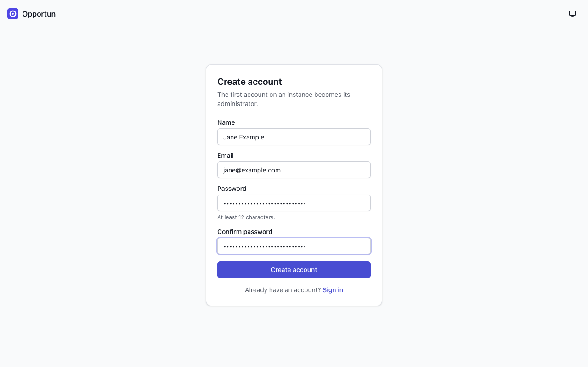
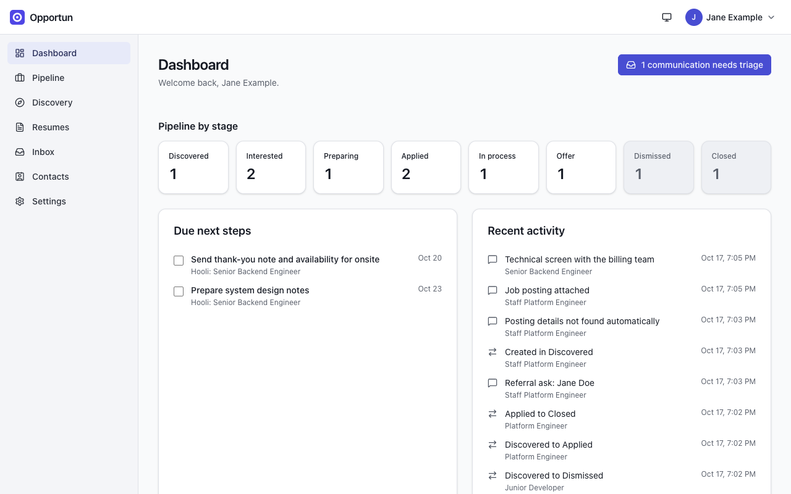
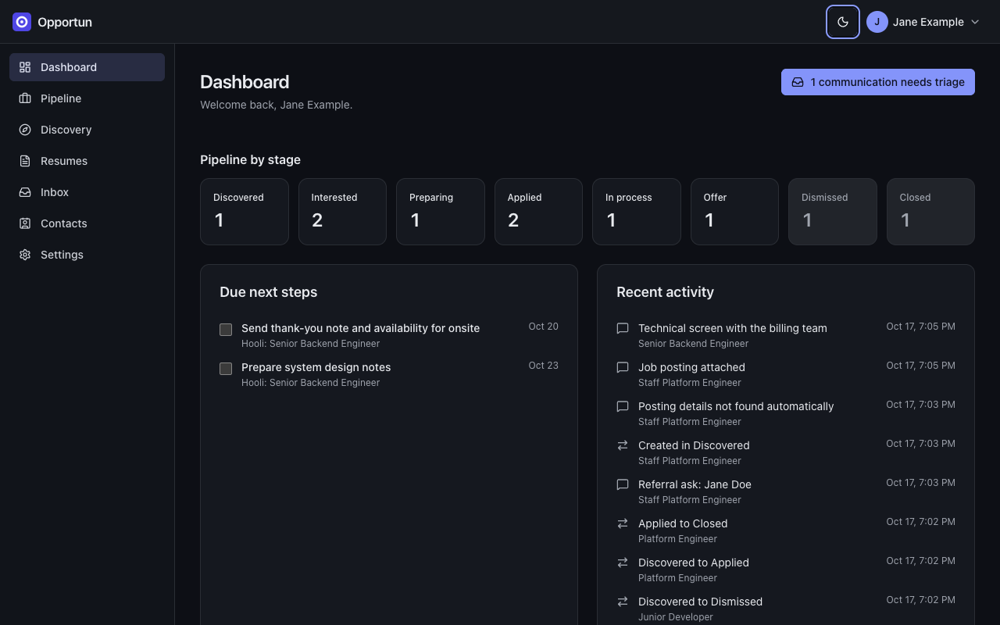

# Getting started

[Guide home](README.md) · Next: [Pipeline](pipeline.md)

## Create the first account

Open your instance in a browser. On a fresh instance, the sign-in page links to
**Create the first account**. The first account becomes the instance administrator.

_The first account on an instance becomes its administrator._

- Passwords need at least 12 characters.
- Registration closes automatically after the first account. To let someone else sign up,
  an administrator opens it again under **Settings > Users** (see
  [Settings](settings.md#users-and-registration)).
- If an administrator has set up Google, GitHub or LinkedIn sign-in, those buttons appear
  on the sign-in page too.

## Sign in

Sign in with your email and password. If you turned on two-factor sign-in, Opportun then asks
for a code from your authenticator app (see [Settings](settings.md#two-factor-sign-in)).

## First-run setup

Before the AI features do anything useful, set up these four things. Each has its own page:

1. **An AI key** under **Settings > AI** ([details](settings.md#ai-provider-keys)). Without
   one, AI features stay off.
2. **Your profile** under **Settings > Profile**: name, headline, contact details and links,
   used on generated resumes.
3. **At least one role target** under **Settings > Role targets**: a title family, a
   seniority range, industries, keywords, locations, work arrangement and pay range.
   Discovery ranks postings against your active role targets, and the inbox uses them to
   filter recruiter outreach.
4. **Google** under **Settings > Integrations**, if your resumes are Google Docs or you
   want Gmail in the inbox. The in-app guided setup and
   [install guide section 2](../install.md#2-quick-start-docker-compose) walk through
   creating your own OAuth client.

## The dashboard

The dashboard is the home page. It shows:

- **Pipeline by stage**: a count per stage. Click one to open the pipeline filtered to it.
- **Due next steps**: next steps due in the next 7 days, with a checkbox to complete them.
- **Recent activity**: stage changes, notes, interviews, attached postings and referral asks.
- A button at the top right when messages in the inbox need triage.

_The dashboard: stage counts across the top, next steps on the left, recent activity on the right._

## Theming

The theme button in the top bar (next to your name) switches between **Light**, **Dark** and
**Auto (system)**. The same choice is under **Settings > Account > Appearance**. It is
saved to your account, so it follows you to every device and browser.

_The same dashboard in the dark theme._

## Keyboard

Lists that you triage often support single keys. The pipeline board uses `j`/`k` to move,
`i` for Interested, `x` to dismiss and `Enter` to open; the discovery review queue uses `j`/`k`,
`i` to accept and `x` to dismiss. The hint above each list shows the keys.

<!-- nav:bottom -->

---

|     | [Guide home](README.md) | [Pipeline →](pipeline.md) |
| :-- | :---------------------: | ------------------------: |
