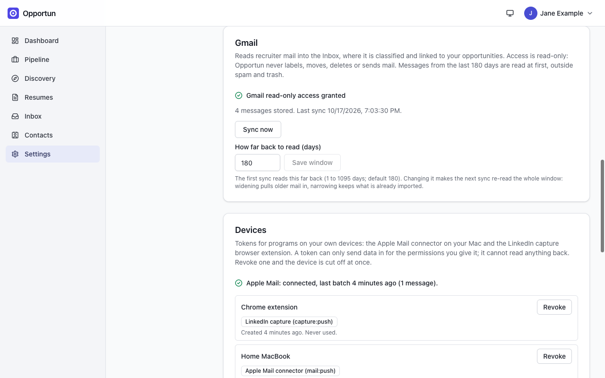
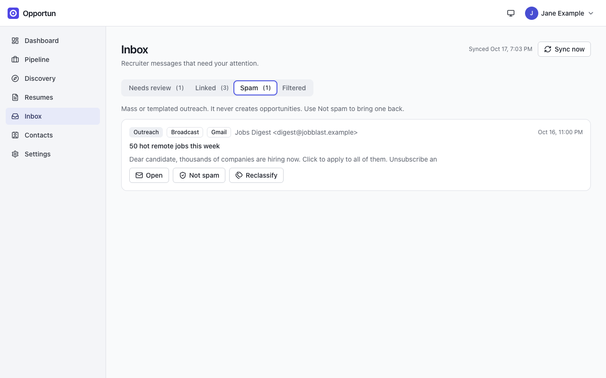

# Inbox

[Guide home](README.md) · Previous: [Resumes](resumes.md) · Next: [Discovery](discovery.md)

The inbox collects recruiter mail, classifies it with AI, links it to the opportunities it is
about, and suggests stage changes. It never sends, labels, moves or deletes mail.

Mail can come from three places, shown as a badge on each message: **Gmail**, **Apple Mail**
(through a connector on your Mac) and **LinkedIn** (messages from your LinkedIn data export,
see [Network](network.md#import-your-linkedin-export)).

## Connect Gmail

Gmail uses the same Google OAuth client as resumes (see
[Resumes](resumes.md#connect-google)), but its read-only access is a separate grant:

1. Open **Settings > Integrations**.
2. Under **Gmail**, press **Connect Gmail (read-only)** and approve the read-only permission.
3. Optionally set **How far back to read (days)**: 1 to 1095, default 180. The first sync
   reads that far back, outside spam and trash. Changing it later makes the next sync re-read
   the whole window: widening pulls older mail in, narrowing keeps what is already there.

Opportun syncs every 15 minutes on its own. **Sync now** (on the Inbox or the Gmail card)
runs one immediately.

_The Gmail card with its lookback window, and the Devices card that tracks the Apple Mail connector._

## How classification works

Each new message goes to the `comms.classify` AI task, which decides:

- **What it is**: Outreach, Scheduling, Follow-up, Rejection, Offer, Networking or Other.
- **For outreach, what kind**: **Targeted** (written to you about a real role),
  **Broadcast** (mass or templated spam) or **Not a fit** (a genuine role that conflicts
  with your role targets, with the reason).
- **Which opportunity it is about**, if any you track.
- **Whether it implies a stage change**, such as an interview request for a role you applied
  to.

Targeted outreach about a role you do not track yet creates an opportunity in New.

Classification costs one AI call per message. A first Gmail sync over 180 days can mean
hundreds of calls; the default model for this task is a small, cheap one, and the per-task
daily budget stops calls once it is spent, until the next UTC day (see
[Settings](settings.md#models-and-budgets)). Messages synced before you added an AI key stay
unclassified and are queued automatically when you add one.

## The four tabs

| Tab          | What it holds                                                                                                                                                                  |
| ------------ | ------------------------------------------------------------------------------------------------------------------------------------------------------------------------------ |
| Needs review | Job-related messages that are not linked to an opportunity yet, messages the classifier was unsure about (below 50% confidence), and messages that just created an opportunity |
| Linked       | Messages linked to an opportunity                                                                                                                                              |
| Spam         | Broadcast outreach. It never creates opportunities. **Not spam** brings one back                                                                                               |
| Filtered     | Not-a-fit outreach, with the reason it does not fit                                                                                                                            |

_Linked mail with its channel badges (Apple Mail, Gmail). The interview request suggests moving Contoso to In process._

_Broadcast outreach lands in Spam and never creates an opportunity._

## Acting on a message

- **Open** shows the snippet Opportun kept, up to 500 characters, and, for Gmail and most
  Apple Mail messages, a link back to the original in your own mailbox (LinkedIn messages,
  and the rare Apple Mail one the connector could not identify precisely, have none). Opportun
  does not store or show the full body.
- **Suggested stage**: **Move to ...** applies the suggested stage change; **Ignore** drops
  the suggestion. A suggestion never moves an opportunity back to an earlier stage, and only
  appears when the classifier is at least 70% confident.
- **Link to opportunity** / **Change link** searches your opportunities by company or title.
  **Unlink** removes the link.
- **Reclassify** corrects the type or outreach kind. Saving a correction (even one that
  changes nothing) clears the review flag on a linked message.

Your corrections are kept. Once a week (Mondays), if you made at least five since the last
time, the `discovery.refine_prompt` task proposes a revised classification prompt. The
proposal appears at the top of **Settings > AI**, and nothing changes until you accept it.

## Apple Mail

Apple Mail has no server API, so a small command-line connector on your Mac reads the
mailboxes you name and pushes them to Opportun with a **device token**. Your mail password
never reaches the server, and the token can only push mail in, never read anything back.

1. Under **Settings > Integrations > Extensions and Connectors**, press **Create token**, tick only
   **Apple Mail connector (mail:push)**, and confirm with your password. Copy the token: it is
   shown once.
2. Build, configure and schedule the connector on your Mac:
   [install guide section 11](../install.md#11-apple-mail-macos) has every command.

The Devices card then reports the connector, for example "Apple Mail: connected, last batch
4 minutes ago (1 message)", and each token's last use. Messages it pushes show the
**Apple Mail** badge and go through the same classification as Gmail. Revoke a token from the
same card and the connector is cut off on its next request.

<!-- nav:bottom -->

---

| [← Resumes](resumes.md) | [Guide home](README.md) | [Discovery →](discovery.md) |
| :---------------------- | :---------------------: | --------------------------: |
