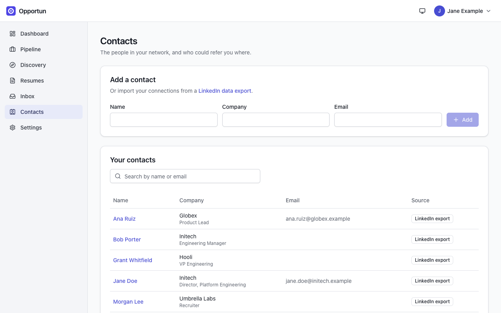
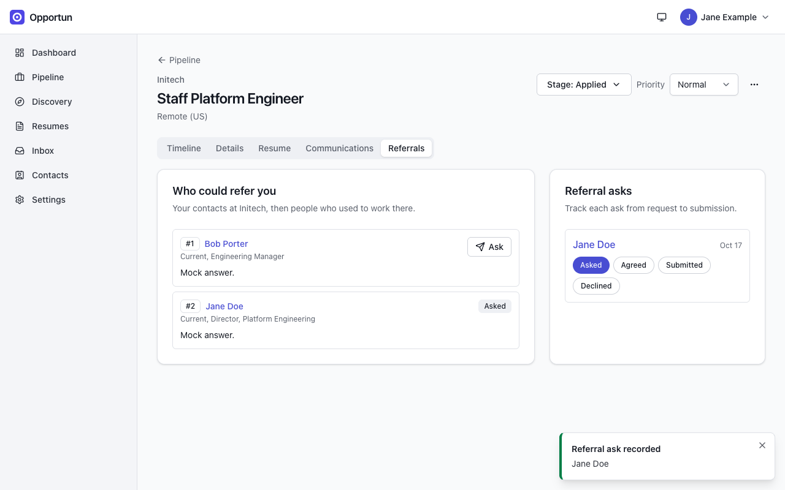

# Network

[Guide home](README.md) · Previous: [Discovery](discovery.md) · Next: [Settings](settings.md)

Contacts are the people who can tell you about a team or refer you in. Opportun maps them to
companies, so each opportunity can show who you know there.

## Contacts

**Contacts** lists everyone, with their company and title, email, and where the contact came
from (a badge such as **LinkedIn export** or **Captured**). Search by name or email, or add
someone by hand with name, company and email.

_Contacts imported from a LinkedIn data export, each mapped to a company._

Open a contact to edit their details: current company, emails, LinkedIn profile URL, how well
you know them (acquaintance, know well, close), tags and notes. The page also lists the
referral asks you have made of them and their company history.

## Import your LinkedIn export

Opportun never connects to LinkedIn. Instead, you ask LinkedIn for a copy of your data and
upload it:

1. Open [LinkedIn's data export page](https://www.linkedin.com/mypreferences/d/download-my-data)
   and choose **Download larger data archive**, then press **Request archive**. The file-by-file
   picker under it does not offer connections or messages, so the larger archive is the one to ask
   for. If that link does not open the right page, in LinkedIn go to **Settings > Data privacy >
   Get a copy of your data**
   ([LinkedIn's instructions](https://www.linkedin.com/help/linkedin/answer/a1339364/downloading-your-account-data)).
2. LinkedIn sends the archive in **two emails**: a first part with a download link, then a
   second part up to 24 hours later. Import whichever zip holds `Connections.csv` and
   `messages.csv`, and import both if you are not sure which does. Nothing is lost by doing so:
   files the importer does not recognize are ignored, and importing an archive it has already
   seen only adds what changed.
3. Upload the zip under **Settings > Import/Export > LinkedIn export** and press **Import
   LinkedIn export**.

Connections become contacts (with company and position); messages land in the inbox with the
**LinkedIn** badge. Importing a newer export later only adds what changed.

## Capture a profile

With the [capture extension](discovery.md#the-capture-extension), open someone's LinkedIn
profile and press **Capture this page**. The profile becomes a contact marked **Captured**, or
updates the existing one. Only the visible text of that one tab is sent, and only when you
click.

## Referrals

On an opportunity, the **Referrals** tab lists **Who could refer you**: your contacts at that
company first, then people who used to work there. The `referral.rationale` AI task ranks them
and writes a one-line reason for each. Opening the tab makes one AI call; the browser reuses
the answer for about ten minutes before asking again.

- **Ask** records that you asked that person. Opportun does not send anything: you write and
  send the message yourself.
- Each ask appears under **Referral asks**, where you track it through **Asked**, **Agreed**,
  **Submitted** and **Declined**. Asks also show on the opportunity's timeline and on the
  contact's page.

_Referral candidates at Initech, ranked by the AI. The rationale here reads "Mock answer." because the screenshot instance used a fake model._

The ranking only knows what your contacts records say (company, title, how well you know
them, notes). It cannot tell who is actually willing to help; you can.

<!-- nav:bottom -->

---

| [← Browser extension](browser-extension.md) | [Guide home](README.md) | [Settings →](settings.md) |
| :------------------------------------------ | :---------------------: | ------------------------: |
