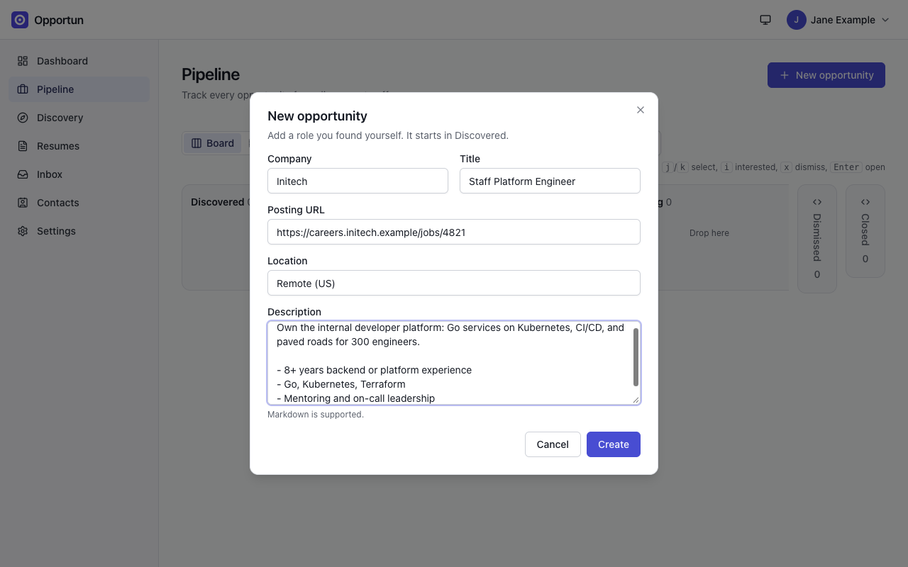
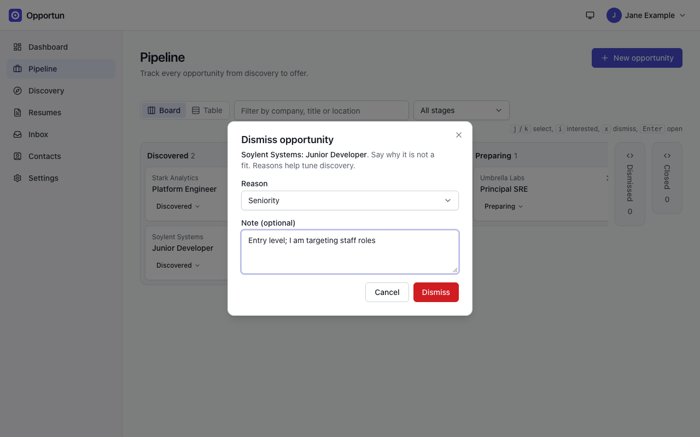

# Pipeline

[Guide home](README.md) · Previous: [Getting started](getting-started.md) · Next: [Resumes](resumes.md)

The pipeline holds every opportunity you track, from first sighting to a closed outcome.

## Stages

An opportunity moves through these stages:

| Stage      | Meaning                                            |
| ---------- | -------------------------------------------------- |
| New        | Found, not yet triaged                             |
| Interested | Worth pursuing                                     |
| Preparing  | Tailoring a resume, lining up a referral           |
| Applied    | Application sent                                   |
| In process | Screens and interviews                             |
| Offer      | An offer is on the table                           |
| Dismissed  | Not a fit (with a reason)                          |
| Closed     | Finished: accepted, rejected, withdrawn or ghosted |

Dismissed and Closed are end states. Moving out of one is an explicit **Reopen**, not an
ordinary stage move.

## The board

**Pipeline** opens on the board: one column per stage, one card per opportunity. Use the
search box to filter by company, title or location, and the stage picker to show a single
stage. **Table** switches to a sortable table of the same opportunities.

- Move a card with its stage button (the menu lists only moves the stage rules allow), or
  drag it to another column.
- The `<>` button on a column header collapses it to a narrow strip with its count, and
  expands it again. Dismissed and Closed start collapsed. Collapsed columns are remembered per
  browser.
- The `x` on a card dismisses it.
- Keyboard: `j`/`k` select a card, `i` marks it Interested, `x` dismisses it, `Enter` opens
  it. Cards in collapsed columns are skipped.
- A card Opportun thinks is a duplicate of one you already track carries a **Possible
  duplicate** badge. Open either card to resolve it.

_The board with two columns collapsed to strips. Each card's stage button opens the move menu._

## Create an opportunity

Click **New opportunity**. Company and title are required; the posting URL, location and
description (Markdown) are optional. It starts in New.

_A role you found yourself. You can leave the description empty and fetch it later with Find posting._

Opportunities also arrive from other places: accepted discovery results
([Discovery](discovery.md)), targeted recruiter mail ([Inbox](inbox.md)), and imports
([Settings](settings.md#import-and-export)).

## Possible duplicates

Opportun matches a new opportunity against your live ones by company, title and location.
Creating one by hand that matches one you already track asks you to confirm: **View the
existing opportunity**, or **Create anyway**. Accepting a matching discovery result offers
**Attach to existing** (links the posting to that opportunity instead of creating a new one)
in place of Create anyway.

Creating anyway flags both opportunities as possible duplicates of each other. On the board,
the new one carries a **Possible duplicate** badge; opening either one shows a banner at the
top naming the other, with **Merge** (the same merge the `...` menu offers, already pointed
at it) and **Not a duplicate**. **Not a duplicate** is remembered for that pair: it will not
come back even if a later edit to either opportunity would otherwise trigger the same match
again.

## Stage moves that need a reason

Dismissing or closing asks for a reason before anything is saved. Cancel and the opportunity
stays where it was.

- **Dismiss** reasons: Seniority, Compensation, Location, Industry, Company, Stale, Other.
  Dismissal reasons feed discovery's prompt refinement (see
  [Discovery](discovery.md#dismissal-learning)).
- **Close** reasons: Accepted, Rejected, Withdrawn, Ghosted.
- Both take an optional note. The reason and note land on the timeline.

_Dismissing asks why. The reason is kept with the opportunity and used to tune discovery._

## The opportunity page

Click a card's title to open it. The header has the stage control, a priority (High, Normal,
Low) and a `...` menu with **Merge into...** for duplicates. A possible-duplicate banner, when
there is one, sits above the tabs (see [Possible duplicates](#possible-duplicates)). Below are
five tabs.

### Timeline

A running log: stage changes, attached postings, referral asks, and entries you add yourself
(Note, Meeting, Interview or Link, each with a title, details in Markdown and, for meetings
and interviews, participants and a time). The **Next steps** panel holds dated to-dos; ones
due within 7 days show on the dashboard.

### Details

The description, the posting link and facts (location, remote, compensation, source, date
added), plus attachments (files up to 20 MB each). **Edit description** and **Edit link**
change them by hand.

### Resume

The resumes attached to this opportunity. Beyond **Create tailored copy** from one of your
base resumes, **Attach an existing resume** links one already registered elsewhere in
Opportun, and **Attach a new document** registers and attaches a document not yet in Opportun
in one step. Each attached resume has its own **Remove from this opportunity** (detach: the
link is cleared, nothing else changes, and it's free to attach elsewhere) and **Delete** (the
same rule as the Resumes page: a hard delete, except a submitted resume is archived instead).
See [Resumes](resumes.md).

### Communications

Every message linked to this opportunity, with the same actions as the inbox (open, change
link, reclassify, accept a suggested stage). See [Inbox](inbox.md).

### Referrals

Contacts who could refer you, ranked by the AI, and the asks you have made. See
[Network](network.md#referrals).

## Find a posting

An opportunity created from an email or an import often has no description. On the Details
tab, **Find posting** looks for one:

1. First, a job board link in a message already linked to the opportunity.
2. Then, the company's job board (detected first if Opportun does not know it yet).

One confident match is attached straight away. Several are listed for you to pick from, with
a search box over the whole board. If no board is reachable, paste the posting link or the
description text instead. LinkedIn links are never fetched: paste the text, or use the
[capture extension](discovery.md#capture-a-posting-yourself).

A large Workday board (see [install guide section
8](../install.md#8-attaching-a-posting-to-an-opportunity)) is read only in part: a note says
so, "Large Workday board: showing the first N of M postings", and invites you to paste the
link or text if your posting is not among them. The note shows next to the candidates, and,
if a single confident match was attached straight away on a board read only in part, it is
kept on the opportunity's timeline too, since that caveat stays true long after the toast
confirming the attach is gone.

The description is stored as text, so it survives the posting being taken down. A description
you wrote or edited yourself is never overwritten; one Opportun wrote, such as the page text
from a browser capture, is replaced by the posting it was standing in for.

An opportunity captured with the [browser extension](browser-extension.md) runs this search on
its own, in the background. When it cannot settle the result it changes nothing and says so:
a note on the Details tab, and a **Posting unconfirmed** mark on the opportunity's card on the
board, so you can see it without opening anything. The note carries the button that resolves
it. If the posting you edited yourself is the reason it stopped, the button looks the board
copy up so you can decide whether to take it.

_Find posting matched the role on the company's Greenhouse board and stored its description and pay range._

More detail, including Workday links: [install guide section 8](../install.md#8-attaching-a-posting-to-an-opportunity).

<!-- nav:bottom -->

---

| [← Getting started](getting-started.md) | [Guide home](README.md) | [Resumes →](resumes.md) |
| :-------------------------------------- | :---------------------: | ----------------------: |
