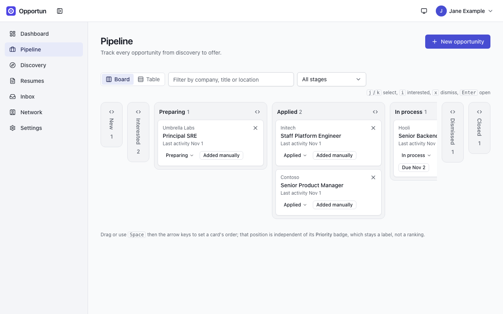
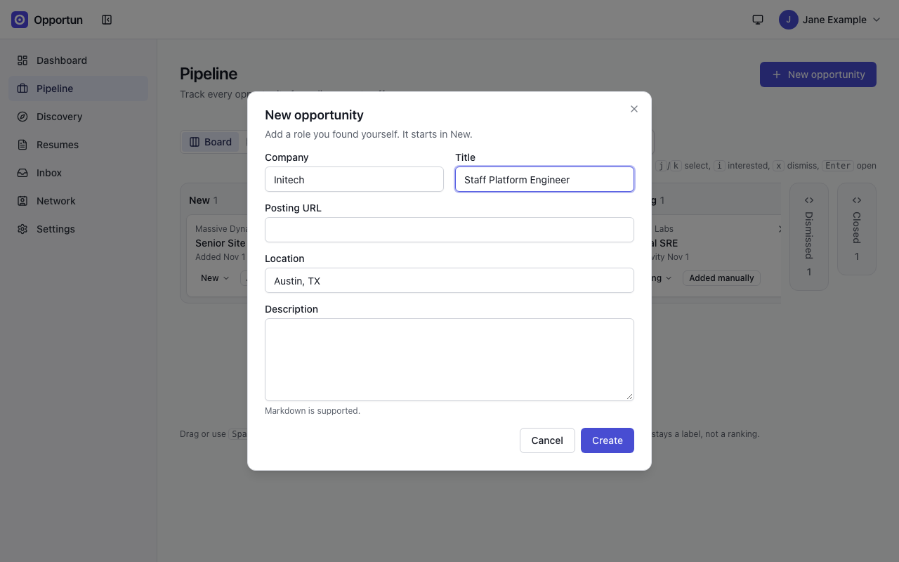
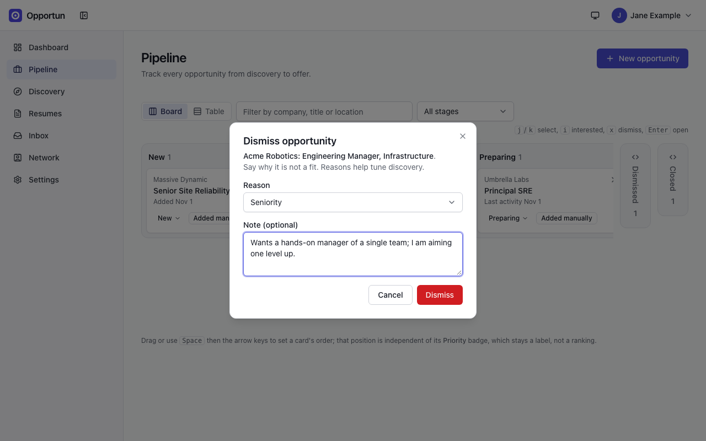
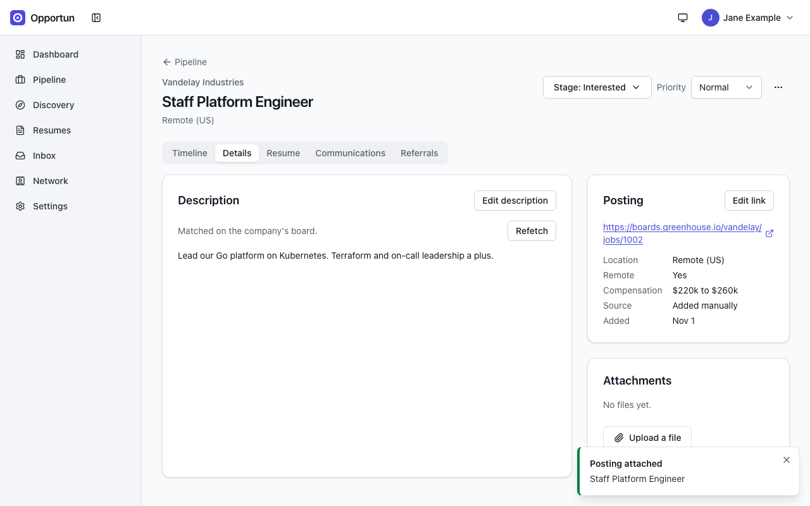

# Pipeline

[Guide home](README.md) · Previous: [Getting started](getting-started.md) · Next: [Resumes](resumes.md)

The pipeline holds every opportunity you track, from first sighting to a closed outcome.

## Stages

An opportunity moves through these stages:

| Stage      | Meaning                                            |
| ---------- | -------------------------------------------------- |
| New        | Found, not yet triaged                             |
| Interested | Worth pursuing                                     |
| Preparing  | Tailoring a resume, lining up a referral           |
| Applied    | Application sent                                   |
| In process | Screens and interviews                             |
| Offer      | An offer is on the table                           |
| Dismissed  | Not a fit (with a reason)                          |
| Closed     | Finished: accepted, rejected, withdrawn or ghosted |

Between New, Interested, Preparing, Applied, In process and Offer, an opportunity can move to
any earlier or later stage in one move, so a mistaken move is corrected directly, and the move
is recorded in its timeline. Any stage can move to Dismissed or Closed. Dismissed and Closed
are end states: moving out of one is an explicit **Reopen**, not an ordinary stage move. A move
the rules refuse says which stages are allowed.

## The board

**Pipeline** opens on the board: one column per stage, one card per opportunity. Use the
search box to filter by company, title or location, and the stage picker to show a single
stage. **Table** switches to a sortable table of the same opportunities.

- Move a card with its stage button (the menu lists only moves the stage rules allow), or
  drag it to another column.
- The `<>` button on a column header collapses it to a narrow strip with its count, and
  expands it again. Dismissed and Closed start collapsed. Collapsed columns are remembered per
  browser.
- The `x` on a card dismisses it.
- Keyboard: `j`/`k` select a card, `i` marks it Interested, `x` dismisses it, `Enter` opens
  it. Cards in collapsed columns are skipped.
- Move a card from the keyboard: focus it, press `Space` to pick it up, move with the arrow
  keys, and press `Space` (or `Enter`) to drop it. `Esc` cancels. A screen reader hears each
  step: "Picked up ...", "... is over the Offer column.", and then either "... was dropped on
  the Offer column." or, when the move is refused, "... was not moved." followed by the reason,
  the same one a mouse drop shows in its message. A move between New, Interested, Preparing,
  Applied, In process and Offer is never refused, so the refusal you can hear is a Dismissed or
  Closed card dropped on one of those columns: "Use Reopen to move a closed opportunity back to
  Interested." A drop within a column while the search box filters it is also announced as not
  moved, because cards cannot be reordered while a search is active. Cancelling is announced as
  "Moving ... was cancelled."
- A card Opportun thinks is a duplicate of one you already track carries a **Possible
  duplicate** badge. Open either card to resolve it.

_The board with every column but Applied and In process collapsed to a strip. Each card's stage button opens the move menu._

## Create an opportunity

Click **New opportunity**. Company and title are required; the posting URL, location and
description (Markdown) are optional. It starts in New.

_A role you found yourself. You can leave the description empty and fetch it later with Find posting._

Opportunities also arrive from other places: accepted discovery results
([Discovery](discovery.md)), targeted recruiter mail ([Inbox](inbox.md)), and imports
([Settings](settings.md#import-and-export)).

## Possible duplicates

Opportun matches a new opportunity against your live ones (any stage but Dismissed) by
company, title and location. The title match ignores seniority words such as Senior, Staff
and Principal at the start or end of a title, so "Staff Platform Engineer" and "Principal
Platform Engineer" at one company and location match. Creating one by hand that matches one
you already track asks you to confirm: **View the existing opportunity**, or **Create
anyway**. Accepting a matching
discovery result asks the same, and also offers **Attach to existing** (links the posting to
that opportunity instead of creating a new one).

Two opportunities are flagged as possible duplicates of each other when:

- You press **Create anyway**.
- You capture a job with the [browser extension](browser-extension.md) and it is kept apart
  from a matching opportunity (see below).
- An opportunity is created, or its company or title is edited, and it has the same company
  as one you track (allowing for variants such as "Inc.") and nearly the same title.
- A daily AI check decides that a less certain pair (same company, similar titles) is the
  same role. This needs AI to be set up.

Capturing a job that matches an opportunity you already track usually fills that opportunity
in. It is kept apart instead when everything that opportunity came from (job alert leads,
accepted discovery results, earlier captures) is a different job on the same site, for
example two LinkedIn jobs with different job ids. The capture then gets an opportunity of its
own, and its timeline gets an entry, **Kept apart from a different LinkedIn posting**, naming
the other job and, if it has a posting link, linking to it. An opportunity that came from
none of these, such as one you created by hand, is filled in as usual, even if you gave it a
posting link. A dismissed opportunity that a capture fills in comes back to Interested. If
the opportunity a capture is kept apart from is dismissed, the capture still gets its own
opportunity and the timeline entry, but no flag.

On the board, both flagged opportunities carry a **Possible duplicate** badge. Opening either
one shows a banner at the top naming the other, with **Merge** (the same merge the `...` menu
offers, already pointed at it) and **Not a duplicate**. Use **Merge** when they are the same
job, and **Not a duplicate** when they are two jobs you want to track separately. **Not a
duplicate** is remembered for that pair: it will not come back even if a later edit to either
opportunity would otherwise trigger the same match again.

## Stage moves that need a reason

Dismissing or closing asks for a reason before anything is saved. Cancel and the opportunity
stays where it was.

- **Dismiss** reasons: Seniority, Compensation, Location, Industry, Company, Stale, Other.
  Dismissal reasons feed discovery's prompt refinement (see
  [Discovery](discovery.md#dismissal-learning)).
- **Close** reasons: Accepted, Rejected, Withdrawn, Ghosted.
- Both take an optional note. The reason and note land on the timeline.

_Dismissing asks why. The reason is kept with the opportunity and used to tune discovery._

## The opportunity page

Click a card's title to open it. The header has the stage control, a priority (High, Normal,
Low) and a `...` menu with **Merge into...** for duplicates. A possible-duplicate banner, when
there is one, sits above the tabs (see [Possible duplicates](#possible-duplicates)). Below are
five tabs.

### Timeline

A running log: stage changes, attached postings, referral asks, and entries you add yourself
(Note, Meeting, Interview or Link, each with a title, details in Markdown and, for meetings
and interviews, participants and a time). The **Next steps** panel holds dated to-dos; ones
due within 7 days show on the dashboard.

### Details

The description, the posting link and facts (location, remote, compensation, source, date
added), plus attachments (files up to 20 MB each). **Edit description** and **Edit link**
change them by hand.

### Resume

The resumes attached to this opportunity. Beyond **Create tailored copy** from one of your
base resumes, **Attach an existing resume** links one already registered elsewhere in
Opportun, and **Attach a new document** registers and attaches a document not yet in Opportun
in one step. Each attached resume has its own **Remove from this opportunity** (detach: the
link is cleared, nothing else changes, and it's free to attach elsewhere) and **Delete** (the
same rule as the Resumes page: a hard delete, except a submitted resume is archived instead).

Each resume appears once, with its kind (Tailored or Base resume), its status and when it was
last updated. Its sends for this opportunity are listed inside it, one line each ("Sent via
Greenhouse on _date_"), with **View application** when the send was an application made through
assisted apply. The file that was sent is kept with that application, on its own page.

A base resume is never attached. Pick one under **Attach an existing resume** and it offers
**Record as sent** instead: say how you sent it (for example "Indeed") and on what day. It is
then listed here as a **Base resume** with that send, and the resume itself does not change, so
the same base can be recorded for other opportunities and still tailored from. Each send has
its own remove control, which removes only that record. See [Resumes](resumes.md).

### Communications

Every message linked to this opportunity, with the same actions as the inbox (open, change
link, reclassify, accept a suggested stage). See [Inbox](inbox.md). The newest message is at the
top; **Newest** at the top right switches to oldest first and back. Each time you open the
opportunity it starts newest first again.

### Referrals

Contacts who could refer you, ranked by the AI, and the asks you have made. See
[Network](network.md#referrals).

### Assisted apply

Where assisted apply is on, the opportunity has an **Assisted apply** panel beside the tabs.
Before you apply, it offers **Apply on _ATS_** when the posting is confirmed and is on a
recognised application system (Greenhouse, Lever or Ashby; Workday as a handoff only), its stage
is Interested, Preparing or Applied, and you have a resume marked Final. When one of these is
missing, the panel says which. **Apply** takes you through the resume, your details and your
answers, then one review of everything. **Confirm review and open** opens the real application
form in a new tab. Opportun never submits anything: you press the site's own Submit button.

A Greenhouse job can sit on the company's own careers page, with a link that ends in
`?gh_jid=` and a number. Opportun does not take that link as Greenhouse on sight. The panel says
"This looks like a Greenhouse job on the company's own careers page. Find the posting on
Greenhouse to apply with assisted apply." and has a **Find posting** button under it (see
[Find a posting](#find-a-posting)). Once Greenhouse's own API shows that the job is on one of
the company's boards, the opportunity is recognised as Greenhouse. **Apply** is then offered
under the same conditions as for any other job (the posting confirmed, the stage, a Final resume),
and the review opens that board's page for the job, never the careers page.

#### Your details when you apply

The **Details** step opens already filled with what Opportun holds for you, field by field:

1. your profile: **Settings > Profile**, and its **Application details** card for first and
   last name, phone country code, school, degree, how you heard about the role, LinkedIn
   profile, website and links;
2. your account, for Email (your sign-in email) and Full name (your display name) only;
3. the same field of the application you reviewed most recently, to any company.

The first of these that holds a field fills it. LinkedIn profile also comes from your profile's
links when exactly one of them is on linkedin.com, and Links from your profile's links. A full
name is never split into first and last name, and Website is never guessed. A value that does
not pass today's checks is not filled in, and the step names it.

Under each value the step says where it came from: "From your profile", "From your account" or
"From your application to _Company_, _date_". A field whose value is not what your profile holds
says **Not in your profile** or **Differs from your profile**, with a **Save to my profile** tick,
off by default. Changes you make on the step apply to this application only. To keep one for
next time, tick **Save to my profile** before **Next: Review**: the application and your profile
are saved together. On a field you emptied, the tick reads **Remove from my profile**.

Phone country code, Location (city), School, Degree and "How did you hear about this role?" are
usually lists on the employer's form (School and Degree are the form's first education entry). Write each as the form's list shows it ("United States",
not "USA"). Phone country code is the country your phone number belongs to, not where you live.
On a Greenhouse form the browser extension chooses the one option that reads exactly as your
value, and leaves the list for you when none does, or when more than one does. It fills
Location (city) and how you heard where the form asks them as a text question with the same
label.

#### Finish on the application site

The last step, **Finish on the application site**, says what to do on that tab:

- **Where the browser extension can fill the form** (a Greenhouse form on Greenhouse's own
  pages, which includes a job from a careers page once Find posting has recognised it and the
  review opened its Greenhouse page, and an extension token with the **Assisted apply**
  permission): go to the form's tab, click the Opportun icon in the toolbar,
  then press **Fill in this application**. The review step says this too, under the button that
  opens the form. Check every field (the extension lists what it filled and what it left for
  you), then press the site's own Submit. See
  [Browser extension](browser-extension.md#filling-an-application-assisted-apply).
- **Otherwise:** fill in the form yourself, copying from **Your details to copy**, with a link
  to **Settings > Integrations > Extensions and Connectors**, where the extension is set up.

**Your details to copy** stays below either way. When you are done, tell Opportun: **I submitted
it** or **I did not submit it**.

#### After you apply

Once you have applied (Submitted, Confirmed, No confirmation seen or ATS refused), the panel
leads with that: the status, when you applied and through which site (and when it was
confirmed), and **View application**. For an application with no confirmation yet it asks what
happened since. **Apply again** stays available as a link, with one line on when to use it: only
if the first application did not go through, or the employer asked you to. The apply flow then
asks for the reason.

## Find a posting

An opportunity created from an email or an import often has no description. On the Details
tab, **Find posting** looks for one:

1. First, if the opportunity's own posting link is a careers page link with a numeric
   `?gh_jid=` and the opportunity is not yet recognised as Greenhouse, that job on the company's
   own Greenhouse boards. Finding it there is what recognises the opportunity as Greenhouse, and
   it comes ahead of any message link or title match.
2. Then, a job board link in a message already linked to the opportunity.
3. Then, the company's job board (detected first if Opportun does not know it yet).

When the careers link names a job that the company's boards do not hold, Find posting never
attaches another posting by itself: anything it finds is offered to choose from. If you wrote the
description yourself, Find posting leaves it as it is and only recognises the job, with Greenhouse's
API checking the company's known boards (at most three); it says "Recognised on Greenhouse", or
that the job was not found on a Greenhouse board known for this company. Saving a new posting link of
this kind with **Edit link** runs the same check. Opportun asks nothing of Greenhouse when an
opportunity is created or its mail is read.

From the Apply panel, the **Find posting** button answers in a line under it: "Posting attached.",
"Recognised on Greenhouse.", "Several postings could be this job. Choose it on the Details tab.", "A
posting on the company's board could be this job. Check it on the Details tab." (when exactly one is
offered), "This job was not found on the company's board. Paste the posting on the Details tab.", "No
job board is known for this company yet. Add its careers page on the Details tab.", or, when you wrote
the description yourself and no known board holds the job, "This job was not found on a Greenhouse
board known for this company. Check the posting link on the Details tab."

One confident match is attached straight away. Several are listed for you to pick from, with
a search box over the whole board. If no board is reachable, paste the posting link or the
description text instead. LinkedIn and Indeed links are never fetched: paste the text, or use
the [capture extension](discovery.md#capture-a-posting-yourself).

A large Workday board (see [install guide section
8](../install.md#8-attaching-a-posting-to-an-opportunity)) is read only in part: a note says
so, "Large Workday board: showing the first N of M postings", and invites you to paste the
link or text if your posting is not among them. The note shows next to the candidates, and,
if a single confident match was attached straight away on a board read only in part, it is
kept on the opportunity's timeline too, since that caveat stays true long after the toast
confirming the attach is gone.

The description is stored as text, so it survives the posting being taken down. A description
you wrote or edited yourself is never overwritten; one Opportun wrote, such as the page text
from a browser capture, is replaced by the posting it was standing in for.

An opportunity captured with the [browser extension](browser-extension.md) runs this search on
its own, in the background. When it cannot settle the result it changes nothing and says so:
a note on the Details tab, and a **Posting unconfirmed** mark on the opportunity's card on the
board, so you can see it without opening anything. The note carries the button that resolves
it. If the posting you edited yourself is the reason it stopped, the button looks the board
copy up so you can decide whether to take it.

_Find posting matched the role on the company's Greenhouse board and stored its description and pay range._

More detail, including Workday links: [install guide section 8](../install.md#8-attaching-a-posting-to-an-opportunity).

<!-- nav:bottom -->

---

| [← Getting started](getting-started.md) | [Guide home](README.md) | [Resumes →](resumes.md) |
| :-------------------------------------- | :---------------------: | ----------------------: |
