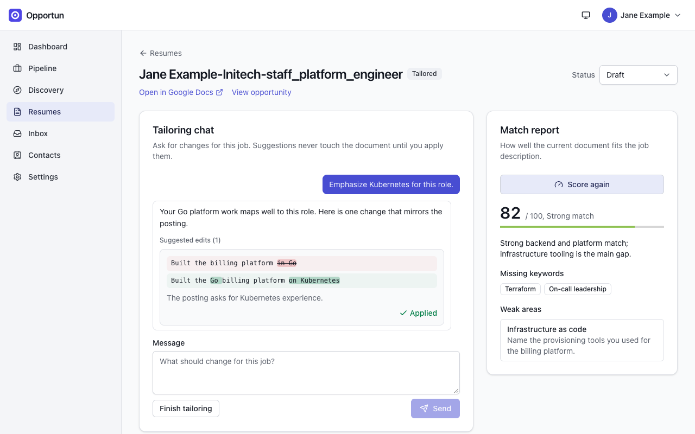

# Resumes

[Guide home](README.md) · Previous: [Pipeline](pipeline.md) · Next: [Inbox](inbox.md)

Opportun does not host your resume. It works on documents you own, in your own Google Drive
or your own Reactive Resume instance, and keeps track of which version went where.

## Base and tailored resumes

- A **base resume** is your general resume. You can register several (for example one for
  engineering roles and one for management roles).
- A **tailored resume** is a copy of a base resume made for one opportunity. It is created
  next to its base, in the same store, and linked to the opportunity.

The **Resumes** page lists both kinds with their status and last update.

## Connect Google

Resumes in Google Docs need the Google connection under **Settings > Integrations > Google**.
You create your own Google Cloud OAuth client (Google has no API for this, so it takes a few
minutes in the Google Cloud console), save its client ID and secret in Opportun, then press
**Connect Google account**. The page has a guided setup with a link for every console step,
and [install guide section 2](../install.md#2-quick-start-docker-compose) covers the same
steps and the common errors.

The resume grant covers Google Docs (read and edit) and Google Drive. Google lists the Drive
permission as access to all your files: it is that broad because no narrower scope can copy a
document you created outside the app. Opportun only touches resume documents, and only when
you register, copy, read for tailoring or scoring, or apply an edit you chose.

## Register a base resume

On **Resumes**, paste the Google Doc link under **Register a base resume** and press
**Register**. The document's title becomes the resume's name.

## Create a tailored copy

Open an opportunity, go to its **Resume** tab, pick a base resume and press **Create tailored
copy**. The copy is named by the template under **Settings > Integrations > Tailored resume
names** (by default your name, the company and the role, for example
`Jane Example-Initech-staff_platform_engineer`). Opportun opens the tailoring workspace.

## The tailoring chat

Tell the assistant what to change for this job ("Emphasize Kubernetes for this role"). It
reads the resume and the job description and replies with suggested edits, each shown as a
removal and an insertion with a one-line rationale.

- Nothing touches the document until you press **Apply** on an edit. Applied edits are
  written into the Google Doc (or Reactive Resume) in place.
- Keep the conversation going until you are happy, then press **Finish tailoring**, which
  moves the resume to In review.
- Standing instructions you want applied every time (for example "never use the word
  'passionate'") go under **Settings > Resume rules**.

_A suggested edit, shown as a diff. It is only a proposal until you press Apply._

**Cost and limits.** Tailoring defaults to the most capable (and most expensive) model in
the policy table, with a large output allowance, and every message is a separate call that
sends the resume, the job description, your resume rules and the whole conversation so far.
Long conversations get more expensive with every turn; check
**Settings > AI > Usage**. The assistant can only rephrase what is there: it does not know
facts about your career that are not in the resume or your message, so read every edit before
you apply it.

## Match score

**Score match** asks the AI how well the current document fits the job description. You get
a score out of 100 with a band (Excellent 90+, Strong 70+, Partial 50+, Stretch below 50), a
one-line summary, missing keywords, and weak areas with a suggestion each. **Score again**
after applying edits.

_The match report next to the chat, after one applied edit._

The score is a model's judgment, not an applicant tracking system's. Use it to find gaps, not
as a prediction of whether you will get a call.

## Status and submission

The **Status** menu on a tailored resume moves it through Draft, In review, Final and
Submitted. Choosing Submitted asks where you sent it (for example "Northwind careers portal")
and records it on the resume, so you can always tell which version a company has.

## Deleting a resume

Each row on the Resumes page has a delete control. It asks first, and what it says depends on
the resume:

- **Not yet submitted:** deleting removes the tracking row only. The Google Doc itself is
  never touched. If it's a base resume with tailored copies, those copies are kept and
  detached (they lose their base, not their content). All tailoring chat history for the
  resume is permanently lost; that part cannot be undone.
- **Already submitted:** a submitted resume can't be fully deleted, because that would destroy
  the record of what was actually sent. It's archived instead: everything about it is left
  exactly as it was (status, the opportunity it's linked to, its tailoring sessions), with
  only an archived timestamp added. Archived resumes stay connected to their opportunity and
  keep working as before; the Resumes page lists them in their own **Archived** section,
  while on the opportunity's Resume tab they stay in the same list with an **Archived** badge.

## Reactive Resume instead of Google Docs

If you run your own [Reactive Resume](https://github.com/reactive-resume/reactive-resume)
6.0 instance, you can keep resumes there instead. Under **Settings > Integrations > Reactive
Resume**, enter the instance address and an API key, press **Validate**, and choose
**Reactive Resume** under **Where new base resumes go**. Register a base resume by pasting its
builder link.

It is lossier than Google Docs: Opportun reads only the visible text fields (no dates, links
or layout), and an edit that crosses bold, italic or link formatting is refused. The instance
must be reachable over https at a public address. Full details:
[install guide section 9](../install.md#9-reactive-resume-optional-instead-of-google-docs).

<!-- nav:bottom -->

---

| [← Pipeline](pipeline.md) | [Guide home](README.md) | [Inbox →](inbox.md) |
| :------------------------ | :---------------------: | ------------------: |
