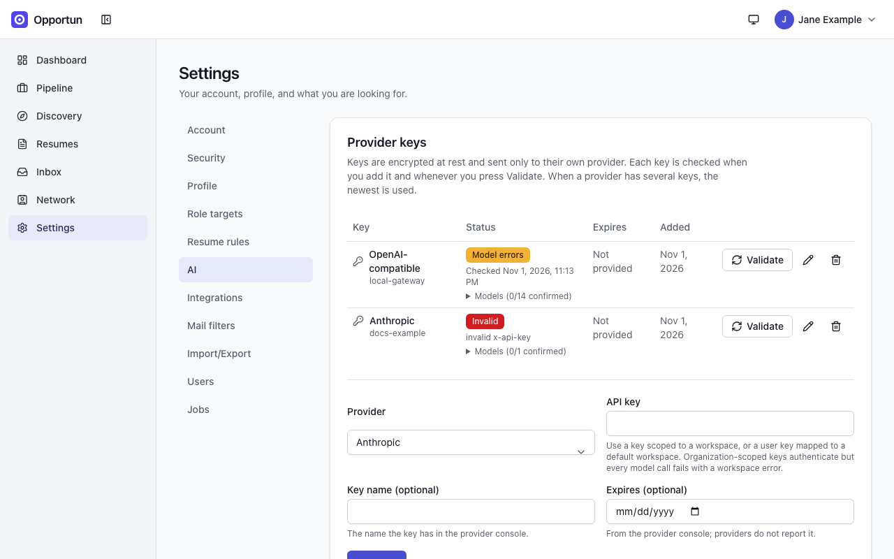
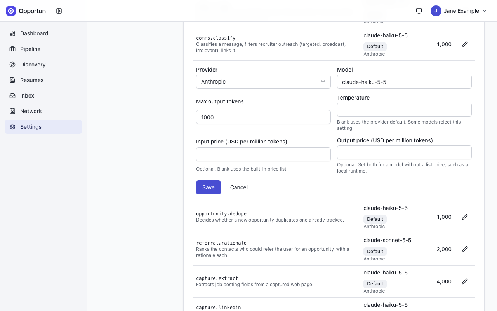
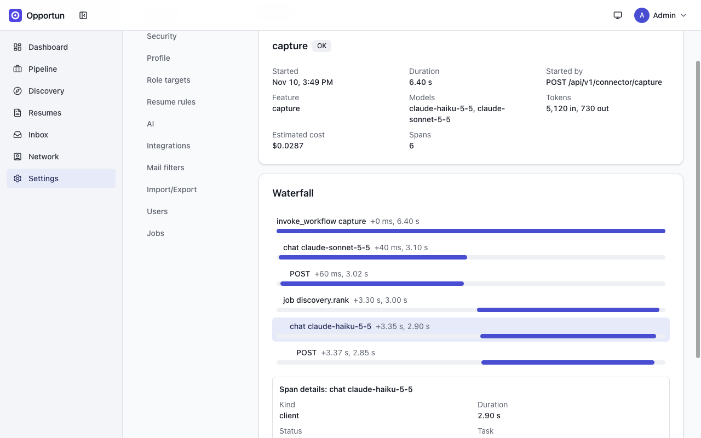
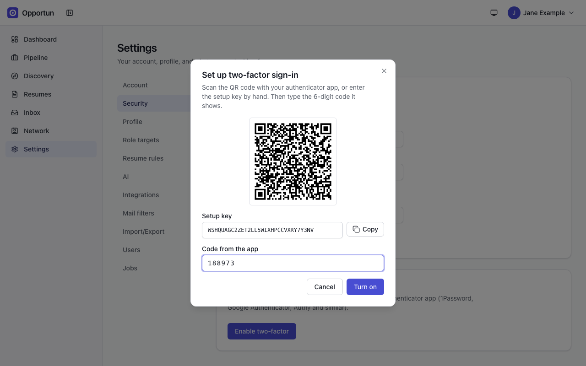
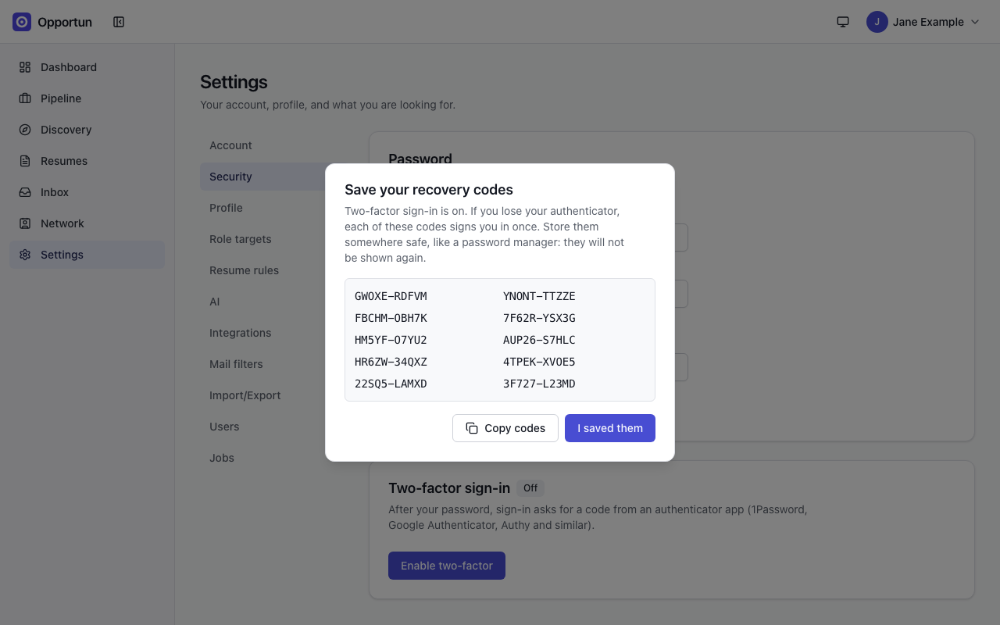
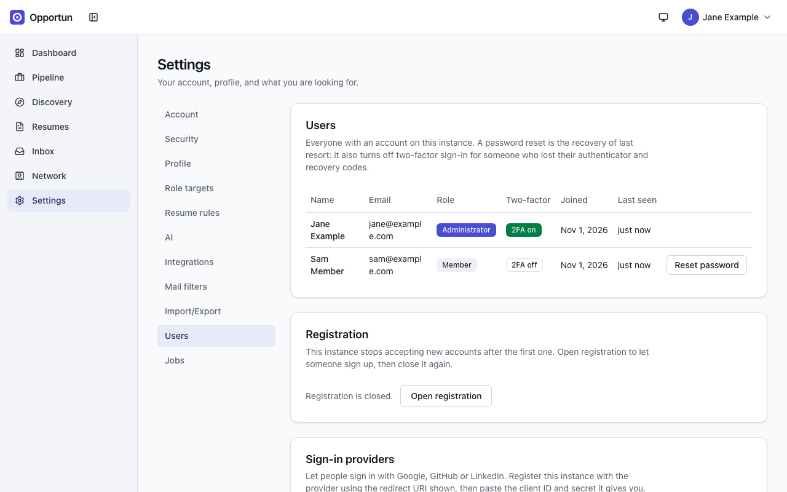
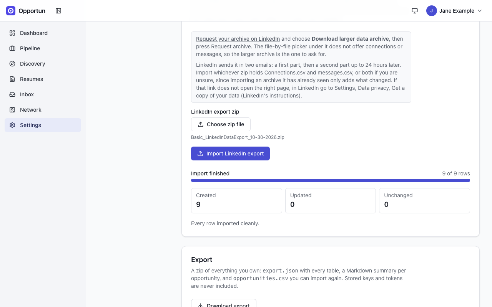
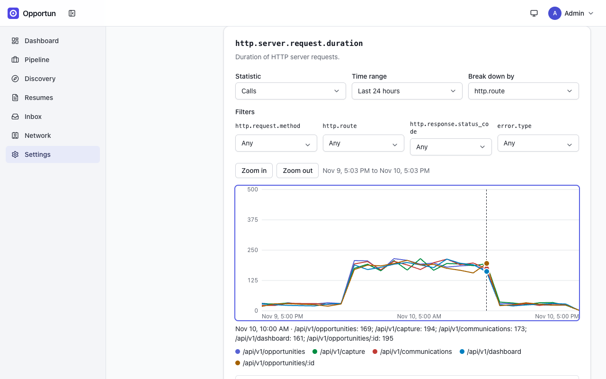
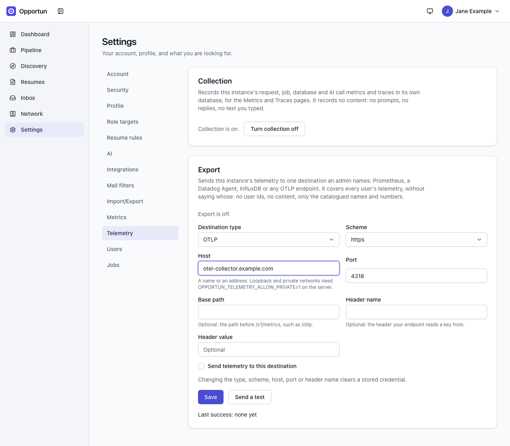

# Settings

[Guide home](README.md) · Previous: [Network](network.md)

**Settings** has these sections: Account, Security, Profile, Role targets, Resume rules, AI,
Integrations, Import/Export, Metrics and, for administrators, Users and Jobs. Profile, role targets and resume
rules are covered in [Getting started](getting-started.md#first-run-setup) and
[Resumes](resumes.md#the-tailoring-chat); Google and Gmail in [Resumes](resumes.md#connect-google)
and [Inbox](inbox.md#connect-gmail).

## Application details

**Settings > Profile** has an **Application details** card below your profile: first name, last
name, country, school, degree, how you heard about the role, LinkedIn profile, website and links.
Write country, school, degree and how you heard as an employer's form lists them (for example
"United States"); the profile's **Location (city)** is written the same way. With your profile's own fields, these are what a new
application starts with (see [Your details when you apply](pipeline.md#your-details-when-you-apply)).
Change them here, or tick **Save to my profile** on an application's Details step. **Save
application details** checks each value first: a web address must be the whole address, starting
with https:// (or http://), and a name one line of plain text.

## AI provider keys

Opportun has no AI of its own: it calls Anthropic, OpenAI or any OpenAI-compatible endpoint
(including a local model server) with your keys, and you pay the provider directly. Add keys
under **Settings > AI > Provider keys**: choose the provider, paste the key, and optionally
name it and record its expiry date from the provider console (providers do not report it).

Keys are encrypted at rest and only ever sent to their own provider. When a provider has
several keys, the newest is used.

Each key is checked when you add it and whenever you press **Validate**. The status chip has
three kinds of answer:

| Chip                                                                     | Meaning                                                                                                                                                                                                 |
| ------------------------------------------------------------------------ | ------------------------------------------------------------------------------------------------------------------------------------------------------------------------------------------------------- |
| **Valid** (green)                                                        | The key works and every model your settings use for it answered                                                                                                                                         |
| **Model errors**, **Bad scope**, or **Valid, expires in N days** (amber) | The key authenticated, but some models failed (Bad scope: an organization-scoped Anthropic key, which must be scoped to a workspace instead), or the expiry date you recorded is within 14 days or past |
| **Invalid** (red)                                                        | The provider rejected the key, with its short reason                                                                                                                                                    |

Expand **Models (n/m confirmed)** on a row to see each model's result. A key not yet checked
shows **Not checked**.



_Two of the three states. The screenshot instance had no real key, so it shows Invalid (a made-up Anthropic key) and Model errors (an endpoint with no model list), not Valid._

Validating an Anthropic key sends a one-token message per model, which costs a fraction of a
cent; OpenAI keys are checked against the free model list. An OpenAI-compatible endpoint
without a model list cannot confirm its models, which shows as Model errors even when calls
would work. These checks are not counted in **Usage** (under
[Models and budgets](#models-and-budgets)) and do not count toward any budget: Opportun keeps
no usage or cost record of them, so your provider's bill is the only place their cost shows.

## Models and budgets

The **Models** table lists every AI task, the provider and model it uses, and its maximum
output. Defaults route cheap, frequent work (mail classification, deduplication, capture)
to a small model and resume tailoring to the most capable one. The pencil on a row edits that
task's policy: provider, model, max output tokens, temperature, a base URL for
OpenAI-compatible endpoints, and input and output prices per million tokens.



_Editing one task's model. Set prices for a model without a list price, such as a local one._

- **Daily budget**: each task may spend $5.00 per UTC day by estimated cost; once reached,
  that task's calls stop until the next day. The page shows the limit; there is no editor
  for it in the app yet.
- **Discovery budget**: dollars a day for ranking discovered postings, suggesting industries, tagging companies and suggesting companies, $1.00 unless you change
  it, on the same UTC day. When it runs out, postings are not skipped: each card says "Waiting for
  budget", and they are ranked on the next budget day, the [best pre-filter
  matches](discovery.md#the-pre-filter) first, then the oldest. With more good new postings each
  day than the budget ranks, a poorer older one can wait for as long as that lasts. While older
  postings wait, a new one is ranked only after waiting with them. A posting the AI provider refuses says so on its card, keeps waiting,
  and is tried again after the others. If it rejects the key itself, every waiting card says so
  and the hourly tries stop until a key works. With no AI key, a posting's card says "AI is not set up" for as long as that is true. Once a key
  works, every such posting, including those that arrived before you added one, waits for budget like
  the rest and is ranked in the same order, with nothing more to do. Raising the budget starts ranking what waits right away. The usage card shows today's spend against it and how many postings wait.
  While a company waits for an industry tag, ranking stops at 90% of the budget and leaves the last
  tenth for tagging and the other tasks; with none waiting, it may use all of it.
  To size it: on 2026-11-11 a ranking call on the default model cost about $0.0065 with prompt
  caching, when postings for one role target are ranked within five minutes of each other (about
  $0.008 without it, measured on 2026-11-10), and tagging 20 companies about $0.0014 without it.
  So $1.00 ranks about 150 postings a day, or about 135 while a company waits for a tag (about 125
  and 114 without caching). These are list-price estimates from two measured runs (one with prompt caching, one
  without), not a provider bill, and
  they change with the model, its prices and the length of your role targets and postings. The
  [measured figures and how they change](discovery.md#the-review-queue) are on the Discovery page,
  and **Discovery ranking cost** on **Settings > AI** shows your own.
  The per-task limit above stays as a hard stop behind it, so a budget above $5.00 still stops
  there.
- **What the AI is sent about your network.** Company suggestions send your AI provider the
  **names of the companies where you know someone**, never a person, and tagging sends a company's
  name, its domain and up to 10 job titles from its board. See
  [Discovery](discovery.md#follow-companies) for exactly what each call sends.
- **Unpriced models** (local or gateway models) count at the highest listed price unless you
  enter the policy's own prices, so they still count toward the budget.
- **Usage** shows the AI calls of the last 7, 30 or 90 days by feature: Resume tailoring,
  Matching, Discovery, Capture, Mail, Companies, Referrals, Duplicates and Integrations. Each
  row gives the calls (and how many failed), input tokens, output tokens and estimated cost.
  Every feature is listed, at zero if it has not been used in the window. Open a feature to see
  each of its tasks, also at zero if it has not run, and the model each task ran on, with the
  provider it was called through in brackets. A task that ran on more than one model gets a row
  for each one, and so does one model reached through two providers (a gateway and the
  provider's own API, say). A task no longer in Opportun (renamed or removed in an update) is
  counted under **Other**, so the total still adds up. Below the features, **By day** lists each
  task's calls per day (UTC), when there were any. Each call keeps the cost it was charged when
  it ran: a later change to the price table or to a model's own prices changes only the calls
  made after it. These are estimates from list prices: your
  provider's bill is the real number. Key checks are not counted (see above). A line under the
  table counts the ranking calls refused by the per-task daily limit, today and in the last 7
  days; one posting can be refused more than once.
- **Discovery ranking cost** shows the calls that score discovered postings, for the last 7 and
  30 days: how many, the input and output tokens per call as median / 90th percentile over the
  calls that ranked, the cost per call, and the total cost, which includes calls that failed.

## Prompts

Every prompt Opportun sends is visible and editable. **Settings > AI > Advanced: prompts**
has one entry per task, with its versions. Saving creates a new version from the active one,
used only after you activate it; **Reset to default** brings back the shipped prompt. Keep the
`{{...}}` placeholders. Discovery ranking prompts are per role target and live on the
[Prompts tab of Discovery](discovery.md#ranking-prompts).

When the weekly refinement job has a proposed classification prompt (see
[Inbox](inbox.md#acting-on-a-message)), it shows at the top of **Settings > AI** for you to
accept or discard.

## AI traces

**AI traces** (`/settings/traces`, linked from **Settings > Metrics**) lists the AI work Opportun did for you, newest first: each
model call, each turn of a tailoring chat, and each workflow that made several calls, such as
a capture that went on to rank the posting. Each row shows when it started, its tasks, the
models, how long it took, the input and output tokens, the estimated cost, and whether it
failed. You see only your own traces. An administrator sees only their own too.

Filter the list by task, model, provider, status (OK or Error) and time range. A tailoring
chat's turns are grouped under **Tailoring chat** with the number of turns, and **Show only
this conversation** lists that chat's turns on their own.

Open a trace to see its waterfall: every step on one time axis, each nested under the step that
started it, with when it started and how long it ran. Select a step with the mouse, or move
through the steps with the arrow keys (Home and End jump to the first and last), and its
details appear below: its kind, status, task, model and provider, the prompt it used (by task
and version, with a link to **Settings > AI**), and the attributes recorded for it. A step that
failed shows its error type in red.



What a trace does not hold:

- **No prompts and no responses.** Opportun never stores what was sent to the model or what
  came back, so a trace cannot show it. A chat trace links to its tailoring session (**Open the
  tailoring session**), where the conversation itself is.
- **No company names, email addresses or other text.** Only the fixed kinds of value Opportun's
  telemetry catalog allows are recorded.

Traces are kept 30 days. One trace keeps at most 2,000 steps; a longer one says it was
truncated.

**Collection is off by default.** An administrator turns it on for the whole instance in
[**Settings > Telemetry**](#telemetry). While it is off, the page says so and nothing new is
recorded; traces recorded earlier are still shown until they age out. On the demo deployment
collection is not available at all, and the page says that instead.

## Security

### Password

**Change password** needs your current password and signs out every other session. Accounts
created through Google, GitHub or LinkedIn sign-in start without a password; to set one, you
first confirm with the linked provider, then choose it here.

### Two-factor sign-in

1. Press **Enable two-factor** and confirm your current password.
2. Scan the QR code with an authenticator app (1Password, Google Authenticator, Authy and
   similar), or type the setup key by hand.
3. Enter the 6-digit code and press **Turn on**.
4. Save the 10 recovery codes somewhere safe, then press **I saved them**. They are not shown
   again.



_Step 2: scan the code or copy the setup key._



_Step 4: each recovery code signs you in once if you lose your authenticator._

From then on, sign-in asks for a code after your password, and the Security page shows how
many recovery codes are left. **Turn off** needs your password plus a code or a recovery code.
Signing in with Google, GitHub or LinkedIn still asks for the code. Lost both the
authenticator and the codes? An administrator can reset your password, which also turns
two-factor off. See [install guide section 13](../install.md#13-two-factor-sign-in).

## Users and registration

Administrators see **Settings > Users**:

- **Users**: everyone on the instance, their role, whether two-factor is on, and when they
  joined. **Reset password** gives a member a temporary password, shown once. It signs them
  out everywhere, revokes their device tokens and turns off their two-factor sign-in. You
  cannot reset your own account this way.
  Both this and opening or closing registration ask for your own password.
- **Password pepper**: shown only when a pepper is configured (see
  [install guide section 4](../install.md#4-configuration-reference)). Names any account that
  has not signed in since the pepper was last rotated, with its last sign-in date, so you can
  tell when it is safe to drop the previous secret during a rotation.
- **Registration**: closed after the first account. **Open registration** to let someone sign
  up, then close it again.
- **Sign-in providers**: Google, GitHub and LinkedIn sign-in, each with the redirect URI to
  register with the provider and fields for its client ID and secret. New accounts from a
  provider are only created while registration is open.



_Two accounts: the administrator and a member._

Each user sees only their own data. More detail: [install guide section 12](../install.md#12-users-and-registration)
and [section 14](../install.md#14-sign-in-with-google-github-or-linkedin).

## Mail filters

**Settings > Mail filters** holds the Gmail label Opportun watches, your allow and deny lists,
the known job senders, and a pattern tester. What each one does, and what happens to a message
they keep out, is in [Mail filters](mail-filters.md).

## Device tokens

Programs on your own devices (the [Apple Mail connector](inbox.md#apple-mail) and the
[capture extension](discovery.md#the-capture-extension)) authenticate with device tokens,
under **Settings > Integrations > Extensions and Connectors**:

- **Create token**: a name, the permissions (**Apple Mail connector (mail:push)**, **Browser
  capture (capture:push)**, and, where assisted apply is on, **Assisted apply
  (apply:assist)**), and your current password. The token is shown once; the server keeps only
  a hash.
- The mail and capture permissions can only push data in; they cannot read anything back.
  **Assisted apply** reads back an application you have handed off (what you reviewed, and its
  resume copy) when the extension asks for that application's posting page, and records the
  thank-you page of an application you said you submitted, when you click **Record
  confirmation page**. To find which application, it can also ask which of yours a job site's
  page belongs to, which tells it that application's title and company (at most 10 such
  questions per 15 minutes). It cannot start, review or submit an application.
- The list shows each token's permissions, when it was created and last used. **Revoke**
  cuts the device off on its next request.

The Extensions and Connectors card is pictured in [Inbox](inbox.md#connect-gmail).

## Import and export

**Settings > Import/Export** has four cards.

- **Import**: a zip or folder with `opportunities.csv` (and optionally `network.csv` and the
  Markdown notes it refers to). A pack made before the Network section was renamed calls that
  file `contacts.csv`, and it imports the same way; a pack holding both is refused. Importing
  the same pack again changes nothing: rows match on company, title and location, and stages
  only move forward.
- **LinkedIn export**: see [Network](network.md#import-your-linkedin-export).
- **Export**: a zip of everything you own (`export.json` with every table, a Markdown summary
  per opportunity, and an `opportunities.csv` you can import again). Stored keys and tokens
  are never included. A CSV cell that would otherwise begin with `=`, `+`, `-` or `@` is
  written with a leading apostrophe, so a spreadsheet shows the text instead of running it as
  a formula; the importer drops that apostrophe again.
- **Backups** (administrators): the server snapshots its database every night at 03:00 server
  time and keeps the 14 newest. **Back up now** takes one immediately. Restoring is done on
  the server: see [install guide section 6](../install.md#6-upgrades-and-backups).



_The LinkedIn export import once it finished: how many rows were created, updated or unchanged._

Back up the data directory (or at least the backups and attachments) somewhere other than the
server itself; a snapshot on the same disk does not survive losing that disk.

## Metrics

**Settings > Metrics** charts how Opportun is used and how it runs, from the instance's own
store: nothing has to be exported, and no outside service is involved. You see the metrics of
your own AI use. An administrator also sees the instance's: HTTP requests, background jobs,
database statements and outbound requests. Nobody sees another user's.

The page lists every metric you can see, with what it measures and its unit. Narrow the list by
name with **Search metrics**, or with **Carries attribute** to the metrics that record one, such
as a route (`http.route`) or a job (`opportun.job.kind`). Select a metric to chart it:

- **Statistic**: for a duration, the number of calls, the errors among them, the mean duration
  or the longest; for a count, its total.
- **Time range**: the last hour, 6 hours, 24 hours, 7 days or 30 days, or a **Custom range**
  with its own start and end. **Zoom in** halves the range and **Zoom out** doubles it. Points
  are kept 30 days, minute by minute for the last 48 hours, so a range of a few hours inside
  those 48 hours is drawn minute by minute, and a longer one hour by hour.
- **Break down by** draws one line per value of an attribute, such as one per route. The eight
  largest get a line each, and the rest are added up as **Other**.
- **Filters** keep only the points with the values you choose, such as `POST` requests.

Move the pointer along the chart to read the values at that time below it. With the keyboard,
tab to the chart and use the arrow keys (Home and End jump to the ends, `+` and `-` zoom around
the cursor). The same numbers are in the table under the chart, one row per step.



**Collection is off by default.** An administrator turns it on for the whole instance in
[**Settings > Telemetry**](#telemetry). While it is off the page says so and nothing new is
recorded; points recorded earlier are still shown until they age out. On the demo deployment
collection is not available at all, and the page says that instead.

## Telemetry

**Settings > Telemetry** holds two switches for the whole instance. Both are off until an
administrator turns them on, and both apply at once, with no restart.

- **Collection** records how Opportun runs, in its own database: HTTP requests, background
  jobs, database statements, outbound requests and AI calls, as metrics and traces. The
  **Metrics** and **AI traces** pages read it. It also writes an event record to the server's
  log for every action in the audit log (a sign-in, an import, an AI key change and the like),
  and for each settings change, job run, discovery source run and error: what happened and
  who, never the details. Nothing leaves the instance.
- **Export** sends the same metrics, traces and event records to one outside destination an
  administrator names. It can be on only while collection is: turning collection off turns
  export off too, and turning collection back on does not resume export by itself.

Everyone signed in sees whether each switch is on, export's destination type, and which kinds
of data it sends. Only an administrator sees where it sends them.

Collected metrics and traces stay in Opportun's own database. They are pruned every hour: metric
points are kept 30 days (minute by minute for the last 48 hours), traces 30 days, and the store
holds at most 250,000 metric rows and 100,000 span rows, oldest first. They are not in your
**Export** zip, because they describe the instance and not your data, and they are in a
[backup](../install.md#6-upgrades-and-backups), which copies the whole database.

### What export sends, and what it never sends

Export covers every user's activity on the instance, without saying whose. Each record carries
only the fixed names and values in Opportun's telemetry catalog (the table at the end of this
section): route templates such as `/api/v1/opportunities/:id`, never a URL with ids or a query;
job kinds; database table names, never SQL; durations, counts and token numbers. It never sends
a user's id, an email address, a name, a prompt, a model's reply or an error message. A model is
named only when Opportun's price table lists it; any other model is sent as `_OTHER`. One limit,
stated plainly: on an instance with few users, the timing of activity can still tell them apart.

Each record is tagged with `service.name` (`opportun`), `service.version` and a random
`service.instance.id` that changes at every start, and nothing about the host it runs on.
`OTEL_*` environment variables change nothing: the destination and its settings come from
this card only.

Metrics leave every 60 seconds. Traces and event records leave in batches every 5 seconds.

### Setting it up

Choose the **Destination type**, then the **Scheme**, **Host** and **Port**, and what the type
needs (see below). Opportun builds the address from these fields; you never enter a URL.
Tick **Send telemetry to this destination** and **Save**. Saving asks for your password again,
and is recorded in the audit log with the type and the kinds of data, never the host or the
credential.



A credential (a header value, a token) is stored encrypted and is never shown again. Leave the
field blank to keep the stored one, or tick **Remove the stored credential**. Changing the type,
scheme, host, port or, for OTLP, the header name clears it, so it cannot follow the destination
somewhere else or go out in a header you did not choose for it.

**Send a test** makes one request to the saved destination and says how it went: accepted,
refused, timed out, a TLS failure, a refused credential, a redirect (which export never
follows), or an error from the destination. If the destination is not allowed, it says why:
for example that it is a private address and the server's operator has not set
`OPPORTUN_TELEMETRY_ALLOW_PRIVATE`. It asks for your password too, and shares its limit of 10 tries in 15 minutes with the other
password checks. Below the form, the card shows the last successful send, the last failure, and
how many records were dropped in the last 24 hours (by a full buffer, for example).

If export is on but cannot send at all, the card shows **Export is blocked: nothing is sent**,
when it last tried and why. This happens, for example, when you saved a private address while
`OPPORTUN_TELEMETRY_ALLOW_PRIVATE=1` was set and the server later started without it. The
notice goes away after a send succeeds; to fix it, change the destination or set the variable
again.

### Where export may send

- **A public destination must use `https`.** Plain `http` to a public address is always refused.
- **Loopback and private networks** (`127.0.0.0/8`, `::1`, `10.0.0.0/8`, `172.16.0.0/12`,
  `192.168.0.0/16`, `fc00::/7`, and `100.64.0.0/10`, where tailnets live), over `http` or
  `https`, only when the server's operator sets `OPPORTUN_TELEMETRY_ALLOW_PRIVATE=1` in its
  environment ([installation](../install.md)). This is the usual case for a Prometheus or a
  Datadog Agent next to Opportun. It is the operator's choice, not a setting on this card.
- **Never**: link-local addresses (`169.254.0.0/16`, `fe80::/10`), unspecified, multicast and
  reserved addresses, and the cloud metadata services (`100.100.100.200`, `fd00:ec2::254`).

Every address the host name resolves to must pass, and the address is checked again before
every batch. The connection goes to the address that was checked, redirects are never followed,
and a request that takes longer than 10 seconds is abandoned.

Neither collection nor export is available on the demo deployment, and the card says so.

### Prometheus

Opportun pushes metrics to Prometheus's own OTLP receiver (Prometheus 3):
there is no scrape endpoint to add. Start Prometheus with the receiver on:

```sh
prometheus --config.file=prometheus.yml --web.enable-otlp-receiver
```

On the card: type **Prometheus**, the scheme, the host and Prometheus's port (9090 by default).
Opportun sends to `/api/v1/otlp/v1/metrics`. If Prometheus sits behind a proxy that checks a
header, put the whole `Authorization` value in **Authorization header value**, such as
`Bearer <token>` or `Basic <base64>`. Prometheus receives metrics only. They appear with
Prometheus's usual names, for example `http_server_request_duration_seconds_count`, labelled by
`http_route`, and `job="opportun"`.

### Datadog

Opportun sends metrics, traces and event records to a Datadog Agent's OTLP receiver over HTTP.
The Agent holds your Datadog API key, so the card takes no credential. Turn the receiver on in
the Agent's configuration:

```sh
DD_OTLP_CONFIG_RECEIVER_PROTOCOLS_HTTP_ENDPOINT=0.0.0.0:4318
DD_OTLP_CONFIG_LOGS_ENABLED=true   # for the event records
DD_LOGS_ENABLED=true
```

On the card: type **Datadog Agent**, the scheme (usually `http` to an Agent on the same host or
network, which needs `OPPORTUN_TELEMETRY_ALLOW_PRIVATE=1`), the Agent's host, and port 4318.

### InfluxDB

InfluxDB has no OTLP receiver, so Opportun writes line protocol to its `/api/v2/write` endpoint
(InfluxDB 2 and 3, and 1.8 or later), once a minute. On the card: type **InfluxDB**, the scheme,
the host, the port (8086 by default), the **Organisation** and **Bucket** to write to, and an
**API token** with write access to that bucket. Each metric becomes a measurement of the same
name (`http.server.request.duration`), its attributes become tags, and a duration's `count`,
`sum`, `min` and `max` become fields. InfluxDB receives metrics only.

### OTLP

Any endpoint that accepts OTLP over HTTP with protobuf, such as an OpenTelemetry Collector or a
hosted service. On the card: type **OTLP**, the scheme, host and port (4318 is the usual one), an
optional **Base path** if the endpoint is not at the root (Opportun adds `/v1/metrics`,
`/v1/traces` and `/v1/logs`), and, if the endpoint needs a key, the **Header name** and **Header
value** it reads it from (for example `x-api-key`). gRPC is not supported.

### The catalogued names

These are the only attribute names a record can carry. **Exported** says whether export sends
the name; the others stay in the instance.

<!-- catalog-keys:start -->

| Name                                    | Value                    | Exported |
| --------------------------------------- | ------------------------ | -------- |
| `http.request.method`                   | one of a fixed list      | yes      |
| `http.route`                            | route template           | yes      |
| `http.response.status_code`             | whole number             | yes      |
| `error.type`                            | class or code            | yes      |
| `opportun.outbound.target`              | one of a fixed list      | yes      |
| `server.address`                        | one of a fixed list      | yes      |
| `db.system.name`                        | one of a fixed list      | yes      |
| `db.operation.name`                     | one of a fixed list      | yes      |
| `db.collection.name`                    | one of a fixed list      | yes      |
| `opportun.job.kind`                     | one of a fixed list      | yes      |
| `opportun.job.outcome`                  | one of a fixed list      | yes      |
| `opportun.obs.signal`                   | one of a fixed list      | yes      |
| `opportun.obs.reason`                   | one of a fixed list      | yes      |
| `user.id`                               | row id                   | no       |
| `client.address`                        | IP address               | no       |
| `opportun.process.signal`               | one of a fixed list      | yes      |
| `opportun.mocks.count`                  | whole number             | yes      |
| `server.port`                           | whole number             | yes      |
| `opportun.db.gate_label`                | class or code            | yes      |
| `opportun.db.gate_held_ms`              | whole number             | yes      |
| `opportun.db.filesystem`                | class or code            | yes      |
| `opportun.count.described`              | whole number             | yes      |
| `opportun.count.deferred`               | whole number             | yes      |
| `opportun.count.skipped`                | whole number             | yes      |
| `opportun.count.truncated`              | whole number             | yes      |
| `opportun.count.read`                   | whole number             | yes      |
| `opportun.count.returned`               | whole number             | yes      |
| `opportun.count.unmatched`              | whole number             | yes      |
| `opportun.count.set`                    | whole number             | yes      |
| `opportun.count.changed`                | whole number             | yes      |
| `opportun.count.cleared`                | whole number             | yes      |
| `opportun.mail.channel`                 | one of a fixed list      | yes      |
| `opportun.db.awaited_outside`           | true or false            | yes      |
| `opportun.warning.type`                 | class or code            | yes      |
| `opportun.warning.code`                 | class or code            | yes      |
| `opportun.job.id`                       | row id                   | no       |
| `opportun.job.attempt`                  | whole number             | yes      |
| `opportun.job.max_attempts`             | whole number             | yes      |
| `opportun.route.id`                     | row id                   | no       |
| `opportun.setting`                      | one of a fixed list      | yes      |
| `opportun.discovery.run_outcome`        | one of a fixed list      | yes      |
| `opportun.count.fetched`                | whole number             | yes      |
| `opportun.count.inserted`               | whole number             | yes      |
| `opportun.count.duplicates`             | whole number             | yes      |
| `opportun.count.invalid`                | whole number             | yes      |
| `opportun.count.suppressed`             | whole number             | yes      |
| `opportun.count.filtered`               | whole number             | yes      |
| `opportun.communication.id`             | row id                   | no       |
| `opportun.company.id`                   | row id                   | no       |
| `opportun.source.id`                    | row id                   | no       |
| `opportun.opportunity.id`               | row id                   | no       |
| `opportun.discovery_result.id`          | row id                   | no       |
| `opportun.dedupe_candidate.id`          | row id                   | no       |
| `opportun.resume.id`                    | row id                   | no       |
| `opportun.rank_batch.id`                | row id                   | no       |
| `opportun.discovery.source_kind`        | one of a fixed list      | yes      |
| `opportun.ats.kind`                     | one of a fixed list      | yes      |
| `opportun.fetch.blocked_reason`         | class or code            | yes      |
| `opportun.oauth.provider`               | one of a fixed list      | yes      |
| `opportun.artifact.target`              | one of a fixed list      | yes      |
| `gen_ai.operation.name`                 | one of a fixed list      | yes      |
| `gen_ai.provider.name`                  | one of a fixed list      | yes      |
| `opportun.ai.provider`                  | one of a fixed list      | yes      |
| `gen_ai.request.model`                  | model id                 | yes      |
| `gen_ai.response.model`                 | model id                 | yes      |
| `gen_ai.request.max_tokens`             | whole number             | yes      |
| `gen_ai.request.temperature`            | number                   | yes      |
| `gen_ai.request.stream`                 | true or false            | yes      |
| `gen_ai.output.type`                    | one of a fixed list      | yes      |
| `gen_ai.prompt.name`                    | one of a fixed list      | yes      |
| `gen_ai.prompt.version`                 | whole number             | yes      |
| `gen_ai.usage.input_tokens`             | whole number             | yes      |
| `gen_ai.usage.output_tokens`            | whole number             | yes      |
| `gen_ai.usage.cache_read.input_tokens`  | whole number             | yes      |
| `gen_ai.usage.cache_write.input_tokens` | whole number             | yes      |
| `gen_ai.response.id`                    | class or code            | no       |
| `gen_ai.response.finish_reasons`        | a list from a fixed list | yes      |
| `gen_ai.response.time_to_first_chunk`   | number                   | yes      |
| `gen_ai.conversation.id`                | row id                   | no       |
| `opportun.ai.task`                      | one of a fixed list      | yes      |
| `opportun.ai.feature`                   | one of a fixed list      | yes      |
| `opportun.ai.prompt.id`                 | row id                   | no       |
| `opportun.ai.attempts`                  | whole number             | yes      |
| `opportun.gen_ai.usage.cost`            | number                   | yes      |
| `gen_ai.agent.name`                     | one of a fixed list      | yes      |
| `gen_ai.token.modality`                 | one of a fixed list      | yes      |
| `opportun.ai.cost.estimated`            | true or false            | yes      |

<!-- catalog-keys:end -->

<!-- nav:bottom -->

---

| [← Network](network.md) | [Guide home](README.md) |     |
| :---------------------- | :---------------------: | --: |
