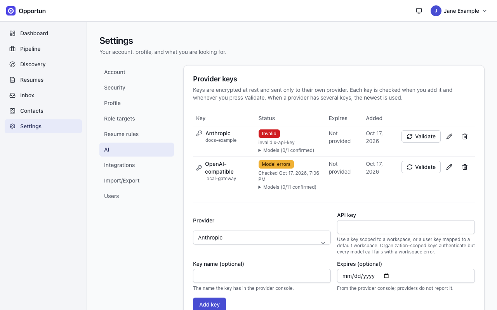
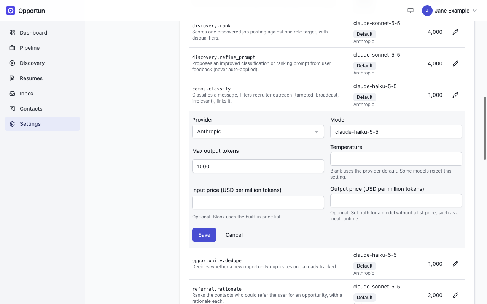
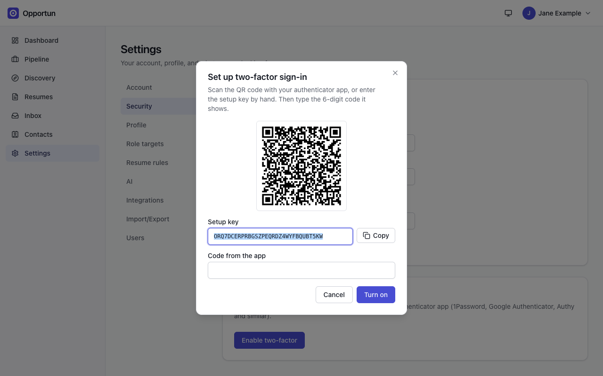
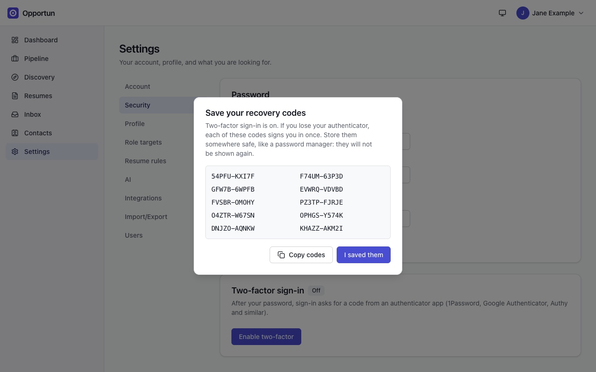
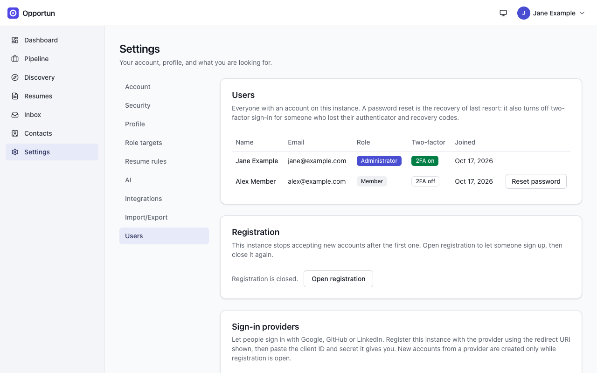
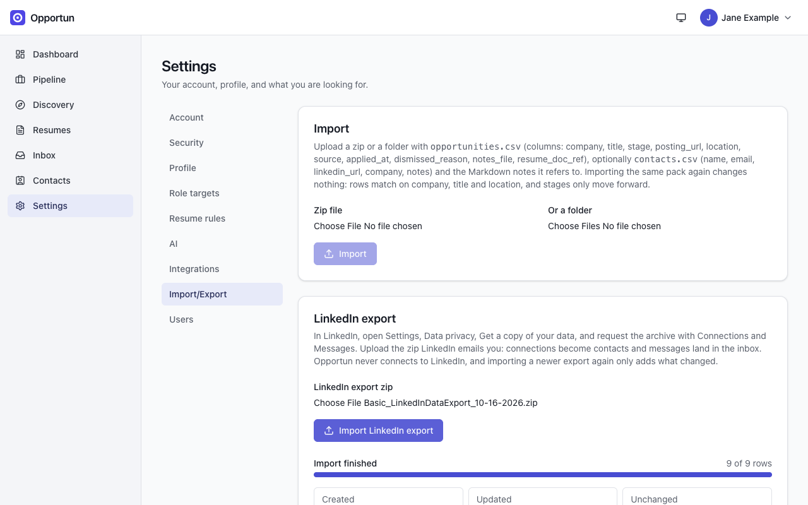

# Settings

[Guide home](README.md) · Previous: [Network](network.md)

**Settings** has these sections: Account, Security, Profile, Role targets, Resume rules, AI,
Integrations, Import/Export and, for administrators, Users. Profile, role targets and resume
rules are covered in [Getting started](getting-started.md#first-run-setup) and
[Resumes](resumes.md#the-tailoring-chat); Google and Gmail in [Resumes](resumes.md#connect-google)
and [Inbox](inbox.md#connect-gmail).

## AI provider keys

Opportun has no AI of its own: it calls Anthropic, OpenAI or any OpenAI-compatible endpoint
(including a local model server) with your keys, and you pay the provider directly. Add keys
under **Settings > AI > Provider keys**: choose the provider, paste the key, and optionally
name it and record its expiry date from the provider console (providers do not report it).

Keys are encrypted at rest and only ever sent to their own provider. When a provider has
several keys, the newest is used.

Each key is checked when you add it and whenever you press **Validate**. The status chip has
three kinds of answer:

| Chip                                                                     | Meaning                                                                                                                                                                                                 |
| ------------------------------------------------------------------------ | ------------------------------------------------------------------------------------------------------------------------------------------------------------------------------------------------------- |
| **Valid** (green)                                                        | The key works and every model your settings use for it answered                                                                                                                                         |
| **Model errors**, **Bad scope**, or **Valid, expires in N days** (amber) | The key authenticated, but some models failed (Bad scope: an organization-scoped Anthropic key, which must be scoped to a workspace instead), or the expiry date you recorded is within 14 days or past |
| **Invalid** (red)                                                        | The provider rejected the key, with its short reason                                                                                                                                                    |

Expand **Models (n/m confirmed)** on a row to see each model's result. A key not yet checked
shows **Not checked**.

_Two of the three states. The screenshot instance had no real key, so it shows Invalid (a made-up Anthropic key) and Model errors (an endpoint with no model list), not Valid._

Validating an Anthropic key sends a one-token message per model, which costs a fraction of a
cent; OpenAI keys are checked against the free model list. An OpenAI-compatible endpoint
without a model list cannot confirm its models, which shows as Model errors even when calls
would work.

## Models and budgets

The **Models** table lists every AI task, the provider and model it uses, and its maximum
output. Defaults route cheap, frequent work (mail classification, deduplication, capture)
to a small model and resume tailoring to the most capable one. The pencil on a row edits that
task's policy: provider, model, max output tokens, temperature, a base URL for
OpenAI-compatible endpoints, and input and output prices per million tokens.

_Editing one task's model. Set prices for a model without a list price, such as a local one._

- **Daily budget**: each task may spend $5.00 per UTC day by estimated cost; once reached,
  that task's calls stop until the next day. The page shows the limit; there is no editor
  for it in the app yet.
- **Unpriced models** (local or gateway models) count at the highest listed price unless you
  enter the policy's own prices, so they still count toward the budget.
- **Usage** shows calls, tokens and estimated cost per task per day for the last 7, 30 or 90
  days. These are estimates from list prices: your provider's bill is the real number.

## Prompts

Every prompt Opportun sends is visible and editable. **Settings > AI > Advanced: prompts**
has one entry per task, with its versions. Saving creates a new version from the active one,
used only after you activate it; **Reset to default** brings back the shipped prompt. Keep the
`{{...}}` placeholders. Discovery ranking prompts are per role target and live on the
[Prompts tab of Discovery](discovery.md#ranking-prompts).

When the weekly refinement job has a proposed classification prompt (see
[Inbox](inbox.md#acting-on-a-message)), it shows at the top of **Settings > AI** for you to
accept or discard.

## Security

### Password

**Change password** needs your current password and signs out every other session. Accounts
created through Google, GitHub or LinkedIn sign-in start without a password; to set one, you
first confirm with the linked provider, then choose it here.

### Two-factor sign-in

1. Press **Enable two-factor** and confirm your current password.
2. Scan the QR code with an authenticator app (1Password, Google Authenticator, Authy and
   similar), or type the setup key by hand.
3. Enter the 6-digit code and press **Turn on**.
4. Save the 10 recovery codes somewhere safe, then press **I saved them**. They are not shown
   again.

_Step 2: scan the code or copy the setup key._

_Step 4: each recovery code signs you in once if you lose your authenticator._

From then on, sign-in asks for a code after your password, and the Security page shows how
many recovery codes are left. **Turn off** needs your password plus a code or a recovery code.
Signing in with Google, GitHub or LinkedIn still asks for the code. Lost both the
authenticator and the codes? An administrator can reset your password, which also turns
two-factor off. See [install guide section 13](../install.md#13-two-factor-sign-in).

## Users and registration

Administrators see **Settings > Users**:

- **Users**: everyone on the instance, their role, whether two-factor is on, and when they
  joined. **Reset password** gives a member a temporary password, shown once. It signs them
  out everywhere, revokes their device tokens and turns off their two-factor sign-in. You
  cannot reset your own account this way.
- **Password pepper**: shown only when a pepper is configured (see
  [install guide section 4](../install.md#4-configuration-reference)). Names any account that
  has not signed in since the pepper was last rotated, with its last sign-in date, so you can
  tell when it is safe to drop the previous secret during a rotation.
- **Registration**: closed after the first account. **Open registration** to let someone sign
  up, then close it again.
- **Sign-in providers**: Google, GitHub and LinkedIn sign-in, each with the redirect URI to
  register with the provider and fields for its client ID and secret. New accounts from a
  provider are only created while registration is open.

_Two accounts: the administrator and a member._

Each user sees only their own data. More detail: [install guide section 12](../install.md#12-users-and-registration)
and [section 14](../install.md#14-sign-in-with-google-github-or-linkedin).

## Device tokens

Programs on your own devices (the [Apple Mail connector](inbox.md#apple-mail) and the
[capture extension](discovery.md#the-capture-extension)) authenticate with device tokens,
under **Settings > Integrations > Extensions and Connectors**:

- **Create token**: a name, the permissions (**Apple Mail connector (mail:push)**, **LinkedIn
  capture (capture:push)**), and your current password. The token is shown once; the server
  keeps only a hash.
- A token can only push data in, for the permissions it has. It cannot read anything back.
- The list shows each token's permissions, when it was created and last used. **Revoke**
  cuts the device off on its next request.

The Devices card is pictured in [Inbox](inbox.md#connect-gmail).

## Import and export

**Settings > Import/Export** has four cards.

- **Import**: a zip or folder with `opportunities.csv` (and optionally `contacts.csv` and the
  Markdown notes it refers to). Importing the same pack again changes nothing: rows match on
  company, title and location, and stages only move forward.
- **LinkedIn export**: see [Network](network.md#import-your-linkedin-export).
- **Export**: a zip of everything you own (`export.json` with every table, a Markdown summary
  per opportunity, and an `opportunities.csv` you can import again). Stored keys and tokens
  are never included. A CSV cell that would otherwise begin with `=`, `+`, `-` or `@` is
  written with a leading apostrophe, so a spreadsheet shows the text instead of running it as
  a formula; the importer drops that apostrophe again.
- **Backups** (administrators): the server snapshots its database every night at 03:00 server
  time and keeps the 14 newest. **Back up now** takes one immediately. Restoring is done on
  the server: see [install guide section 6](../install.md#6-upgrades-and-backups).

_The import cards. The LinkedIn import reports how many rows were created, updated or unchanged._

Back up the data directory (or at least the backups and attachments) somewhere other than the
server itself; a snapshot on the same disk does not survive losing that disk.

<!-- nav:bottom -->

---

| [← Network](network.md) | [Guide home](README.md) |     |
| :---------------------- | :---------------------: | --: |
